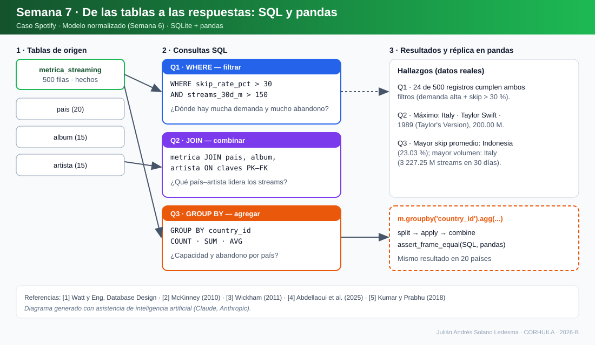

# Semana 7 · Consultas SQL y pandas — Caso Spotify

**Asignatura:** Ciencia de Datos · Unidad 2 · Corte 2 · Periodo 2026-B
**Autor:** Julián Andrés Solano Ledesma · CORHUILA · jasolano-2024a@corhuila.edu.co
**Tipo de actividad:** formativa (opcional, sin nota)

---

## 1. Contexto y objetivo

Esta entrega continúa el caso **Spotify — capacidad de streaming y curación regional** (dataset de Kaggle *Spotify Global Streaming Data 2024*, 500 registros). Sobre el modelo normalizado construido en la Semana 6 se escriben **tres consultas SQL** (`WHERE`, `JOIN`, `GROUP BY`) y se **reproduce en pandas** la consulta de agregación, explicando qué pregunta responde cada una.

SQL es el lenguaje declarativo estándar para consultar bases relacionales: `SELECT` proyecta columnas, `WHERE` filtra filas, `JOIN` combina tablas mediante claves y `GROUP BY` con funciones de agregado resume grupos [1]. pandas ofrece el análogo en Python mediante `groupby`, basado en el patrón *split–apply–combine* [2], [3]. Se usa SQL cuando el dato vive en un motor relacional y pandas cuando el análisis continúa en Python; ambos conviven con alternativas NoSQL según la estructura del dato [4], [5].



*Figura 1. De las tablas a las respuestas. Diagrama generado con asistencia de inteligencia artificial (Claude, Anthropic).*

## 2. Datos y esquema usado

| Tabla | Filas | Papel en las consultas |
|---|---:|---|
| `metrica_streaming` | 500 | Tabla de hechos: `streams_30d_m`, `skip_rate_pct`, claves a país, álbum, género y plan |
| `pais` | 20 | Dimensión geográfica (`country_id`, `nombre`, `region`) |
| `album` | 15 | Une cada métrica con su artista (`artist_id`) |
| `artista` | 15 | Nombre del artista |

Las tablas están en [`datos/`](datos/) y su diseño (PK, FK, restricciones) en el [esquema de la Semana 6](../06-week/esquema-spotify.sql). Motor: SQLite en memoria.

## 3. Consultas SQL

El código completo está en [`consultas-spotify.sql`](consultas-spotify.sql) y se ejecuta en [`consultas-sql-pandas.ipynb`](consultas-sql-pandas.ipynb).

### Q1 · `WHERE` — filtro

```sql
SELECT metric_id, country_id, streams_30d_m, skip_rate_pct
FROM   metrica_streaming
WHERE  skip_rate_pct > 30
  AND  streams_30d_m > 150
ORDER  BY skip_rate_pct DESC;
```

**Qué responde:** ¿en qué registros país–álbum hay a la vez **alta demanda** (> 150 M streams en 30 días) y **alto abandono** (*skip rate* > 30 %)?
**Resultado:** 24 de 500 registros (4,8 %). El mayor abandono es el registro 133 (país 6) con 39,14 % y 163,39 M streams. Son los puntos donde la curación regional es más urgente.

### Q2 · `JOIN` — combinación de tablas

```sql
SELECT p.nombre AS pais, ar.nombre AS artista, al.titulo AS album, m.streams_30d_m
FROM   metrica_streaming m
JOIN   pais    p  ON p.country_id = m.country_id
JOIN   album   al ON al.album_id  = m.album_id
JOIN   artista ar ON ar.artist_id = al.artist_id
ORDER  BY m.streams_30d_m DESC
LIMIT  10;
```

**Qué responde:** ¿qué combinaciones país–artista–álbum concentran la mayor demanda reciente? Cada `JOIN` declara su condición `ON` sobre claves PK–FK; omitirla produciría un producto cartesiano [1].
**Resultado:** el máximo es Italy · Taylor Swift · *1989 (Taylor's Version)* con 200,00 M, seguido de Brazil · Ed Sheeran (199,91 M) y Argentina · Ariana Grande (198,06 M).

### Q3 · `GROUP BY` — agregación

```sql
SELECT country_id,
       COUNT(*)                     AS n_registros,
       ROUND(SUM(streams_30d_m), 2) AS streams_30d_total_m,
       ROUND(AVG(skip_rate_pct), 2) AS skip_rate_prom_pct
FROM   metrica_streaming
GROUP  BY country_id
ORDER  BY skip_rate_prom_pct DESC;
```

**Qué responde:** ¿cuánta capacidad (streams en 30 días) y cuánto abandono promedio tiene cada país?
**Resultado (top 5 por abandono):**

| País | Registros | Streams 30 d (M) | Skip prom. (%) |
|---|---:|---:|---:|
| Indonesia | 25 | 2 197,80 | 23,03 |
| Japan | 23 | 2 471,66 | 22,76 |
| Argentina | 27 | 2 834,22 | 22,62 |
| Italy | 34 | 3 227,25 | 22,37 |
| South Africa | 32 | 3 024,99 | 22,07 |

Italy es el país con mayor volumen (3 227,25 M) y Indonesia el de mayor abandono promedio; la diferencia entre países es moderada (rango del promedio ≈ 20–23 %), por lo que el abandono no distingue por sí solo a un mercado.

## 4. Equivalente en pandas

```python
m = pd.read_csv('datos/metrica_streaming.csv')
p3 = (m.groupby('country_id')
        .agg(n_registros=('metric_id', 'count'),
             streams_30d_total_m=('streams_30d_m', 'sum'),
             skip_rate_prom_pct=('skip_rate_pct', 'mean'))
        .round(2)
        .sort_values('skip_rate_prom_pct', ascending=False)
        .reset_index())
```

`groupby` divide los datos por `country_id`, aplica `count`, `sum` y `mean` a cada grupo y recombina el resultado [2], [3]. La equivalencia se **verifica por código** con `pd.testing.assert_frame_equal` entre la salida SQL y la de pandas: coinciden en los 20 países.

| SQL | pandas |
|---|---|
| `WHERE` | indexación booleana `m[m.skip_rate_pct > 30]` |
| `GROUP BY` | `groupby(...)` |
| `COUNT / SUM / AVG` | `count / sum / mean` en `agg` |
| `ORDER BY ... DESC` | `sort_values(..., ascending=False)` |

## 5. Limitaciones

El dataset es de 500 filas agregadas por país–álbum y no incluye usuarios individuales, por lo que los hallazgos describen patrones de mercado, no comportamiento personal. Los umbrales de Q1 (30 % y 150 M) son criterios de ejemplo, no estándares de la industria.

## 6. Cómo reproducir

```bash
pip install pandas jupyter
jupyter notebook consultas-sql-pandas.ipynb   # Ejecutar todas las celdas
# o ejecutar consultas-spotify.sql en SQLite tras cargar los CSV de datos/
```

## 7. Estructura de la entrega

```
07-week/
├── README.md
├── diagrama-consultas.svg
├── consultas-spotify.sql
├── consultas-sql-pandas.ipynb
└── datos/            (pais, album, artista, genero, plan_suscripcion, metrica_streaming)
```

## Referencias

[1] A. Watt y N. Eng, *Database Design*, 2.ª ed. Victoria, BC, Canadá: BCcampus, 2014, cap. «SQL DML». [En línea]. Disponible: https://opentextbc.ca/dbdesign01/chapter/chapter-sql-dml/

[2] W. McKinney, «Data structures for statistical computing in Python», en *Proc. 9th Python in Science Conf. (SciPy)*, 2010, pp. 56–61, doi: 10.25080/Majora-92bf1922-00a. [En línea]. Disponible: https://proceedings.scipy.org/articles/Majora-92bf1922-00a

[3] H. Wickham, «The split-apply-combine strategy for data analysis», *J. Stat. Softw.*, vol. 40, n.º 1, pp. 1–29, 2011, doi: 10.18637/jss.v040.i01. [En línea]. Disponible: https://www.jstatsoft.org/article/view/v040i01

[4] A. Abdellaoui *et al.*, «SQL and NoSQL databases: A comparative study with perspectives on IA-based migration approach», *Eng. Proc.*, vol. 112, n.º 1, art. 72, 2025, doi: 10.3390/engproc2025112072. [En línea]. Disponible: https://www.mdpi.com/2673-4591/112/1/72

[5] A. Kumar y B. Prabhu, «Comparison of NoSQL database and traditional database – An emphatic analysis», *Int. J. Informatics Visualization (JOIV)*, vol. 2, n.º 2, pp. 51–55, 2018. [En línea]. Disponible: https://joiv.org/index.php/joiv/article/view/58
