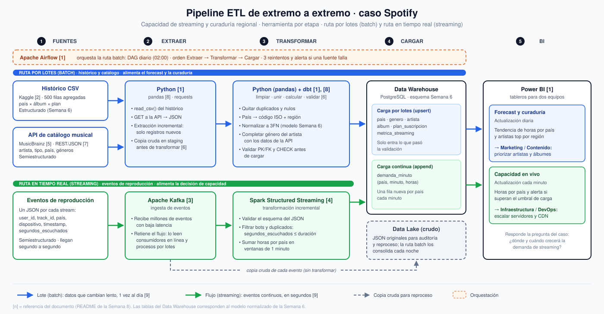

# Semana 8 — Diseña un pipeline ETL

**Programa:** Ingeniería Industrial · **Asignatura:** Ciencia de Datos
**Unidad 2:** Modelamiento, transformación y conexión de datos · **Corte 2 · Semana 8** · **Periodo:** 2026-B
**Modalidad:** Individual/parejas · **Tipo:** Formativa (sin nota)

**Julián Andrés Solano Ledesma**

> Continuación del caso **Spotify — capacidad de streaming y curaduría regional**. Aquí se diseña el pipeline ETL completo del caso (fuentes → extraer → transformar → cargar → BI), con la herramienta de cada paso. También se justifica qué partes van en lotes y cuáles en tiempo real, y se consume una API pública con Python (parte opcional).

---

## 1. Pipeline ETL del caso

Un proceso ETL **extrae** los datos de sus fuentes, los **transforma** (limpia, une y calcula) y los **carga** en el almacén donde se analizan [1]. Es la columna vertebral de la preparación de datos [1] y una pieza crítica de todo data warehouse, porque de ella depende que lo que llega al análisis sea correcto y consistente [6]. Un **pipeline** encadena esos pasos para que corran solos, y la **orquestación** decide el orden, el horario y qué hacer si algo falla [1].



*Fig. 1. Pipeline ETL de extremo a extremo del caso Spotify. Diagrama generado con asistencia de inteligencia artificial (Claude, Anthropic), a partir del diseño desarrollado en este documento.*

El caso tiene dos decisiones con urgencias distintas, por eso el pipeline tiene **dos rutas** que terminan en el mismo Data Warehouse y en el mismo tablero de BI:

- la **ruta por lotes (batch)** procesa el histórico y el catálogo musical para el forecast y la curaduría;
- la **ruta en tiempo real (streaming)** procesa los eventos de reproducción para la decisión de capacidad de servidores y CDN.

### 1.1 Herramienta por etapa

| Etapa | Ruta batch | Ruta streaming | Qué hace en el caso |
|---|---|---|---|
| **1. Fuentes** | Histórico CSV *Spotify Global Streaming Data (2024)* de Kaggle [2] (500 filas agregadas, normalizado en la [Semana 6](../../06-week/02-optional-activity/README.md)) y API REST de catálogo **MusicBrainz** [5], [7] | Eventos de reproducción en JSON (`user_id`, `track_id`, país, dispositivo, `timestamp`, `segundos_escuchados`) | Reúne los datos estructurados y semiestructurados del inventario del Corte 1 |
| **2. Extraer** | **Python** (`pandas.read_csv`, `requests`) [1], [8] | **Apache Kafka** [3] | Batch: lee el CSV y pide el catálogo a la API en JSON. Streaming: recibe cada evento con baja latencia y lo conserva para que otros procesos lo vuelvan a leer [3] |
| **3. Transformar** | **Python (pandas) + dbt** [1], [8] | **Spark Structured Streaming** [4] | Limpia, normaliza y valida (ver 1.2). Spark agrega las horas por país en ventanas de 1 minuto [4] |
| **4. Cargar** | **PostgreSQL** (Data Warehouse), carga incremental (*upsert*) en las tablas de la Semana 6 | PostgreSQL, tabla `demanda_minuto` (*append*), y copia cruda de los eventos en el **Data Lake** | Solo entra al almacén lo que pasó la validación. El lago guarda el original para auditoría y reproceso |
| **5. BI** | **Power BI** [1]: tablero de forecast y curaduría (diario) | **Power BI**: tablero de capacidad en vivo (cada minuto) | Entrega cada respuesta al equipo que decide: Contenido o Infraestructura |
| **Orquestación** | **Apache Airflow** [1]: DAG diario a las 02:00, 3 reintentos y alerta si una fuente falla | No aplica: el flujo corre de forma continua | Airflow decide *qué corre y cuándo*; Kafka *transporta* los eventos. Las dos herramientas se complementan [1] |

### 1.2 Reglas de transformación

Transformar no es solo cambiar el formato: es limpiar, unir y calcular [1]. Es el paso donde se depuran los errores, se homogeneizan los valores y se concilian datos de varias fuentes antes de cargar [6]. El riesgo contrario, *cargar datos sin transformarlos ni validarlos*, es un error común [1].

| Regla | Ruta | Problema que evita |
|---|---|---|
| Eliminar registros duplicados y con campos clave nulos | Ambas | Contar dos veces la misma reproducción o métrica |
| `segundos_escuchados ≤ duracion_seg` de la canción | Streaming | Reproducciones infladas por bots: el reto de **veracidad** de la Semana 2 |
| Nombre de país → código ISO y región | Batch | Que "USA", "United States" y "US" se cuenten como tres países distintos |
| Un solo año de lanzamiento por álbum (el más frecuente; si hay empate, el menor) | Batch | El CSV [2] trae 6 años distintos para cada álbum. La Semana 6 fijó esta regla y el pipeline la vuelve a aplicar en cada recarga |
| Normalizar a 3FN según el modelo de la Semana 6 | Batch | Repetir nombres de artistas o álbumes y crear anomalías de actualización |
| Completar `genero_principal` del artista con la API | Batch | La columna que quedó vacía en la tabla `artista` (ver sección 3) |
| Validar PK, FK y `CHECK` antes de cargar | Batch | Filas huérfanas o valores imposibles en el Data Warehouse |

Antes de transformar, la ruta batch guarda una copia de lo extraído en un área de preparación (*staging*) [6]. Así un fallo en la transformación no obliga a extraer de nuevo. En la ruta streaming, la copia cruda al Data Lake sigue la variante **ELT**: los datos se cargan primero y se transforman después, en la consolidación nocturna [1].

---

## 2. ¿Qué parte es batch y qué parte es streaming?

**Criterio:** cada parte se decide por la **velocidad con la que hay que tomar la decisión** que alimenta, no por el volumen de datos ni por la herramienta de moda. Elegir entre lotes y flujo continuo es, en el fondo, un equilibrio entre exactitud, latencia y costo [9]. El streaming solo se justifica donde la latencia importa. Usar Kafka cuando bastaba un ETL por lotes es uno de los errores más comunes [1].

| Parte del pipeline | Modo | Plazo de la decisión | Justificación |
|---|---|---|---|
| Eventos de reproducción → Kafka → Spark → `demanda_minuto` | **Streaming** | Segundos a minutos | Un pico de demanda en un país hay que detectarlo *mientras ocurre* para escalar servidores y CDN antes de que el servicio se degrade. Kafka ingiere grandes volúmenes de eventos con baja latencia [3], y Structured Streaming los agrega por ventanas de tiempo de forma incremental, sin reprocesar todo el histórico [4] |
| Histórico CSV de Kaggle [2] | **Batch** (carga inicial y recarga solo si cambia el archivo) | No aplica | Es un archivo estático y ya agregado; tratarlo como flujo continuo no aporta ninguna información nueva [1] |
| API de catálogo (MusicBrainz) | **Batch** diario | Un día | Artistas y géneros cambian lento. Una consulta diaria basta y evita saturar un servicio externo con peticiones innecesarias |
| Consolidación de los eventos del Data Lake → `metrica_streaming` | **Batch** nocturno | Trimestre | El forecast trimestral y la curaduría de artistas no mejoran con datos al segundo, y un proceso por lotes es más simple y barato de operar. Kafka permite que estos consumidores *offline* lean los mismos eventos que consume la ruta en línea [3] |

**¿Por qué no todo en streaming ni todo en batch?** Si todo fuera batch, Infraestructura vería el pico del día siguiente, cuando el servicio ya se degradó. Si todo fuera streaming, el histórico y el catálogo pagarían la complejidad de un sistema continuo sin ganar nada. El riesgo típico de tener dos rutas es duplicar la lógica de transformación. Se reduce porque Structured Streaming usa la misma API declarativa (DataFrames/SQL) que el procesamiento por lotes [4]: la regla anti-bots se escribe una sola vez y se reutiliza en la consolidación nocturna.

---

## 3. (Opcional) Consumo de una API pública con Python

**API elegida: MusicBrainz**, una base abierta de metadatos musicales que mantiene su comunidad y se ofrece como servicio web [5]. Corresponde a la fuente *"Metadatos de catálogo musical (API)"* del inventario del Corte 1, responde en JSON por HTTP y no requiere clave. Una API entrega datos bajo demanda, normalmente en JSON, mediante peticiones HTTP [1]. MusicBrainz sigue el estilo arquitectónico REST: cada recurso, como un artista, tiene su propia URL y se consulta con una petición HTTP `GET` estándar que no depende de peticiones anteriores [7].

El cuaderno [`consumo-api-musicbrainz.ipynb`](./consumo-api-musicbrainz.ipynb) usa `requests` y pandas [8] para ejecutar un mini-ETL sobre los 3 primeros artistas de la tabla `artista` de la Semana 6:

```python
import requests

BASE_URL = "https://musicbrainz.org/ws/2"
HEADERS = {"User-Agent": "CORHUILA-CienciaDatos-Semana08/1.0 ( https://github.com/Drewroots/electiva-vi-ciencia-datos-2026-b-g1 )"}

# Extraer: buscar el artista y pedir su detalle con géneros (JSON)
busqueda = requests.get(f"{BASE_URL}/artist/", headers=HEADERS, timeout=15,
                        params={"query": 'artist:"BTS"', "limit": 1, "fmt": "json"}).json()
mbid = busqueda["artists"][0]["id"]
detalle = requests.get(f"{BASE_URL}/artist/{mbid}", headers=HEADERS, timeout=15,
                       params={"inc": "genres", "fmt": "json"}).json()

# Transformar: género con más votos de la comunidad
genero = max(detalle["genres"], key=lambda g: g["count"])["name"]   # -> 'k-pop'
```

La versión completa del cuaderno además **reintenta** si el servidor responde 503 o 429, espera 1 segundo entre peticiones y verifica con `assert` que cada búsqueda coincida al 100 %. Así se aplica la buena práctica de manejar los fallos de una fuente en lugar de ignorarlos [1].

**Resultado: 3 registros** (guardados en [`datos/catalogo_musicbrainz.csv`](./datos/catalogo_musicbrainz.csv)):

| `artist_id` | Nombre | Tipo | País (ISO) | Año de inicio | `genero_principal` |
|---:|---|---|:---:|:---:|---|
| 1 | Ariana Grande | Person | US | 1993 | pop |
| 2 | BLACKPINK | Group | KR | 2016 | k-pop |
| 3 | BTS | Group | KR | 2013 | k-pop |

El `artist_id` es la clave de la tabla `artista` de la Semana 6. Por eso estos registros se pueden cargar directamente para completar la columna `genero_principal`, que el CSV de Kaggle [2] dejó vacía. En el pipeline de la Fig. 1, este código es el paso **Extraer** de la ruta batch, ejecutado una vez al día por Airflow.

**Cómo reproducirlo**

```bash
pip install requests pandas jupyter
jupyter notebook consumo-api-musicbrainz.ipynb   # ejecutar todas las celdas
```

El cuaderno lee `../../06-week/02-optional-activity/datos-normalizados/artista.csv`, así que debe ejecutarse desde esta carpeta del repositorio.

---

## 4. Archivos de la entrega

```
08-week/02-optional-activity/
├── README.md                        ← este documento
├── diagrama-pipeline-etl.svg        ← Fig. 1: pipeline con herramienta por etapa
├── consumo-api-musicbrainz.ipynb    ← parte opcional: API pública con requests
└── datos/
    └── catalogo_musicbrainz.csv     ← 3 registros extraídos y transformados
```

---

## 5. Referencias (formato IEEE)

[1] Corporación Universitaria del Huila (CORHUILA), "Ciencia de Datos · Semana 8 · Conexión de datos: APIs, ETL y pipelines," Objeto Virtual de Aprendizaje (OVA), Neiva, Colombia, 2026. [Online]. Disponible: https://code-corhuila.github.io/ova-web/2026-B/ciencia-datos/08-week/01-session/

[2] A. Soundankar, "Spotify Global Streaming Data (2024)," Kaggle, 2024. [Online]. Disponible: https://www.kaggle.com/datasets/atharvasoundankar/spotify-global-streaming-data-2024

[3] J. Kreps, N. Narkhede, and J. Rao, "Kafka: A distributed messaging system for log processing," in *Proc. Int. Workshop on Networking Meets Databases (NetDB)*, Athens, Greece, jun. 2011. [Online]. Disponible: https://people.csail.mit.edu/matei/courses/2015/6.S897/readings/kafka.pdf

[4] M. Armbrust *et al.*, "Structured Streaming: A declarative API for real-time applications in Apache Spark," in *Proc. 2018 Int. Conf. Management of Data (SIGMOD)*, Houston, TX, USA, 2018, pp. 601–613, doi: 10.1145/3183713.3190664.

[5] A. Swartz, "MusicBrainz: A semantic Web service," *IEEE Intelligent Systems*, vol. 17, no. 1, pp. 76–77, 2002, doi: 10.1109/5254.988466.

[6] P. Vassiliadis, "A survey of extract–transform–load technology," *International Journal of Data Warehousing and Mining*, vol. 5, no. 3, pp. 1–27, 2009, doi: 10.4018/jdwm.2009070101.

[7] R. T. Fielding, "Architectural styles and the design of network-based software architectures," Ph.D. dissertation, Dept. Inf. Comput. Sci., Univ. California, Irvine, CA, USA, 2000. [Online]. Disponible: https://www.ics.uci.edu/~fielding/pubs/dissertation/top.htm

[8] W. McKinney, "Data structures for statistical computing in Python," in *Proc. 9th Python in Science Conf. (SciPy)*, Austin, TX, USA, 2010, pp. 56–61, doi: 10.25080/Majora-92bf1922-00a.

[9] T. Akidau *et al.*, "The dataflow model: A practical approach to balancing correctness, latency, and cost in massive-scale, unbounded, out-of-order data processing," *Proceedings of the VLDB Endowment*, vol. 8, no. 12, pp. 1792–1803, 2015, doi: 10.14778/2824032.2824076.
