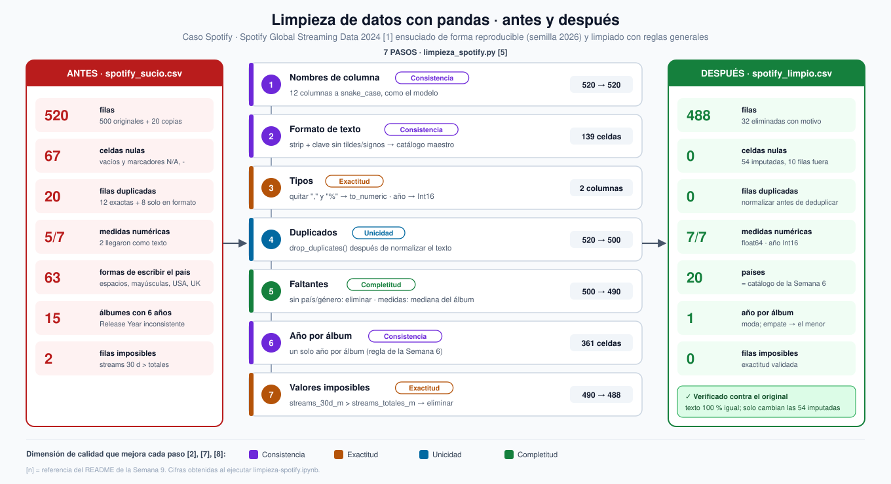

# Semana 9 — Limpieza de un dataset

**Programa:** Ingeniería Industrial · **Asignatura:** Ciencia de Datos
**Unidad 2:** Modelamiento, transformación y conexión de datos · **Corte 2 · Semana 9** · **Periodo:** 2026-B
**Modalidad:** Individual/parejas · **Tipo:** Formativa (sin nota)

**Julián Andrés Solano Ledesma**

> Continuación del caso **Spotify — capacidad de streaming y curaduría regional**. Aquí se limpia con pandas el dataset de Kaggle *Spotify Global Streaming Data (2024)* [2]: se cuentan los nulos, se eliminan o imputan los faltantes, se quitan los duplicados, se corrigen los tipos y se normalizan los formatos de texto. Se documenta el antes y el después, y se comentan dos dimensiones de calidad que mejoraron. Es el paso **Transformar** de la ruta batch del pipeline de la [Semana 8](../../08-week/02-optional-activity/README.md).
>
> La actividad calificable del Corte 2 está aparte, en [`c2-activity/`](./c2-activity/README.md).

---

## 1. El dataset y por qué se ensució

"Basura entra, basura sale": la calidad del análisis depende de la calidad de los datos, y la limpieza suele consumir la mayor parte del tiempo de un proyecto [1], [6]. Los problemas de calidad aparecen en los propios registros: valores faltantes, duplicados, errores de escritura y convenciones distintas para un mismo dato [5].

El CSV original de Kaggle [2] (500 filas × 12 columnas) **no tiene nulos ni duplicados**. Sí trae dos problemas reales: el año de lanzamiento de cada álbum aparece con 6 valores distintos, como ya mostró la Semana 6, y hay **2 filas imposibles**, con más streams en 30 días que en total. Para ejercitar toda la limpieza, la guía permite *ensuciar* el dataset. Se hizo con [`ensuciar_spotify.py`](./ensuciar_spotify.py), con **semilla fija (2026)** para que el archivo siempre sea el mismo:

| Problema inyectado | Columna | Celdas o filas | Ejemplo |
|---|---|---:|---|
| Formato de texto | `Country`, `Genre`, `Platform Type`, `Artist` | 125 | `"  germany "`, `"PREMIUM"`, `"Free   "` |
| Sinónimos | `Country`, `Genre` | 17 | `"USA"`, `"UK"`, `"Hip-Hop"`, `"KPOP"` |
| Número guardado como texto | `Total Streams`, `Skip Rate` | 100 | `"3,695.53"`, `"2.24%"` |
| Faltantes | 6 columnas | 65 | celdas vacías y marcadores `"N/A"` y `"-"` |
| Duplicados | fila completa | 20 | 12 copias exactas y 8 que solo cambian el país a MAYÚSCULAS |

**Regla del ejercicio:** la limpieza **no usa** lo que se sabe de la inyección. Aplica reglas generales y valida los textos contra los **catálogos maestros** del modelo de la [Semana 6](../../06-week/02-optional-activity/README.md) (`pais`, `genero`, `plan_suscripcion`, `artista`, `album`).

---

## 2. Script de limpieza en pandas

La limpieza está en [`limpieza_spotify.py`](./limpieza_spotify.py), escrita con pandas [7]. El cuaderno [`limpieza-spotify.ipynb`](./limpieza-spotify.ipynb) la ejecuta y muestra la evidencia. Cada paso queda registrado en una **bitácora**, porque no documentar las transformaciones hace que el trabajo no sea reproducible [1].



*Fig. 1. Antes, pasos de limpieza y después. Diagrama generado con asistencia de inteligencia artificial (Claude, Anthropic), a partir de los resultados del cuaderno.*

| # | Paso | Qué hace | Efecto | Dimensión |
|---:|---|---|---|---|
| 1 | **Nombres de columna** | `rename` a snake_case en español, igual que el modelo de la Semana 6 | 12 columnas | Consistencia |
| 2 | **Formato de texto** | `str.strip()` + una *clave* sin tildes, espacios ni signos que se compara con el catálogo maestro (`"  germany "` → `germany` → `Germany`), más un diccionario de sinónimos (`USA` → `United States`) | 139 celdas corregidas, 0 fuera de catálogo | Consistencia |
| 3 | **Tipos** | Quita `","` y `"%"` y aplica `pd.to_numeric`; el año pasa a `Int16` y el texto a `category` | 2 columnas de texto → `float64` | Exactitud |
| 4 | **Duplicados** | `drop_duplicates()` **después** de normalizar el texto | 20 filas eliminadas (520 → 500) | Unicidad |
| 5 | **Faltantes** | Sin país o género no hay registro → `dropna`. Las medidas se **imputan** con la mediana de su álbum (`groupby` + `fillna`) | 10 filas eliminadas, 54 celdas imputadas (500 → 490) | Completitud |
| 6 | **Año por álbum** | Un solo año por álbum: el más frecuente y, si hay empate, el menor (regla de la Semana 6) | 361 celdas unificadas | Consistencia |
| 7 | **Valores imposibles** | Elimina filas con `streams_30d_m > streams_totales_m` o *skip* fuera de 0–100 % | 2 filas eliminadas (490 → 488) | Exactitud |

Fragmento central del paso 2, que resuelve los formatos de texto inconsistentes:

```python
def clave(texto):
    """Forma comparable: sin tildes, sin espacios ni signos y en minúsculas."""
    sin_tildes = unicodedata.normalize("NFKD", str(texto)).encode("ascii", "ignore").decode()
    return re.sub(r"[^a-z0-9]", "", sin_tildes.lower())

for col in ["pais", "artista", "album", "genero", "plan"]:
    oficial = {clave(v): v for v in catalogos[col]}          # "unitedstates" -> "United States"
    oficial.update({k: v for k, v in SINONIMOS.items() if v in catalogos[col]})   # "usa" -> ...
    df[col] = df[col].map(lambda v: oficial.get(clave(v), pd.NA) if pd.notna(v) else v)
```

**¿Eliminar o imputar?** Eliminar filas con faltantes sin pensar es un error común; a veces conviene imputar [1]. Por eso se distinguió según el tipo de columna:

- **Claves** (país, género): sin ellas la fila no se puede asignar a un mercado ni cargar en el modelo, porque sus FK quedarían vacías. Se eliminan **10 filas**.
- **Medidas** (oyentes, *skip rate*, duración, streams de 30 días): eliminar la fila perdería las otras 5 medidas válidas. Se imputan con la **mediana del álbum**, que no se deja arrastrar por valores extremos.

Como los faltantes se inyectaron al azar, el caso equivale a datos *completamente ausentes al azar*. Bajo ese mecanismo, la ausencia no depende de los valores, así que imputar no introduce un sesgo sistemático [8]. Aun así, imputar con una mediana reduce la variabilidad de la columna, y debe tenerse en cuenta en análisis posteriores.

---

## 3. Evidencia antes / después

Resultado del cuaderno, que lee el archivo sucio reconociendo los marcadores `"N/A"` y `"-"`:

| Indicador | Antes | Después |
|---|---:|---:|
| **Filas** | 520 | **488** |
| **Celdas nulas** | 67 | **0** |
| **Filas duplicadas exactas** | 12 | **0** |
| Medidas numéricas (de 7) | 5 | **7** |
| Celdas de texto con espacios sobrantes | 53 | **0** |
| Formas distintas de escribir el país | 63 | **20** |
| Formas distintas de escribir el plan | 10 | **2** |
| Álbumes con más de un año de lanzamiento | 15 | **0** |
| Filas imposibles (streams 30 d > totales) | 2 | **0** |
| Memoria | 224,5 KB | **30,4 KB** |

**Nulos por columna (antes):**

| Columna | Nulos |
|---|---:|
| `Monthly Listeners (Millions)` | 25 |
| `Skip Rate (%)` | 15 |
| `Streams Last 30 Days (Millions)` | 11 |
| `Country` | 6 |
| `Avg Stream Duration (Min)` | 6 |
| `Genre` | 4 |

Este conteo es mayor que lo inyectado (67 frente a 65) porque algunas copias duplicadas repiten una celda vacía.

**Las 32 filas eliminadas, una por una:** 20 duplicadas + 10 sin clave + 2 imposibles = 32, y 520 − 32 = **488**.

**Verificación contra el original:** como el archivo sucio sale del CSV original, se comprobó que la limpieza no alteró ningún dato válido. Cada fila limpia se emparejó con su fila original, y las **488 de 488** encontraron pareja.

- En el texto (país, artista, género, plan) hay **0 diferencias**.
- En las medidas hay exactamente **54 diferencias**, que son las 54 celdas imputadas.

---

## 4. Dos dimensiones de calidad que mejoraron

La calidad de datos es multidimensional: un dato es de calidad cuando sirve para el uso que le da quien lo consume, y eso se mide en varias dimensiones a la vez [3]. El OVA define cinco: completitud, exactitud, consistencia, unicidad y vigencia [1]. Las dos que más mejoraron en este caso son **consistencia** y **unicidad**.

### 4.1 Consistencia: ¿los valores coinciden en formato y entre registros?

La consistencia exige que un mismo dato se represente siempre igual y que no haya contradicciones entre registros [1], [4].

| Antes | Después |
|---|---|
| El país escrito de **63 formas**: `"  Italy "`, `"ITALY"`, `"italy"`, `"USA"`... | **20** países, exactamente los del catálogo `pais` |
| El plan escrito de **10 formas**: `"Free"`, `"FREE"`, `"free"`, `"Free   "`... | **2**: `Free` y `Premium` |
| **15** álbumes con 6 años de lanzamiento cada uno | **1** año por álbum (361 celdas unificadas) |
| Nombres de columna en inglés con espacios y unidades | snake_case, iguales a las columnas del modelo de la Semana 6 |

**Por qué importa para el caso:** con 63 formas de escribir el país, un `GROUP BY pais` como el de la Semana 7 habría repartido la demanda de Italia en varias filas distintas. Eso subestima el mercado y desordena el ranking que decide dónde escalar servidores. La regla del OVA lo resume: una sola forma de escribir cada categoría [1].

### 4.2 Unicidad: ¿hay registros repetidos?

La unicidad exige que cada observación del mundo real aparezca una sola vez [1], [9].

| Antes | Después |
|---|---|
| 12 duplicados exactos visibles con `df.duplicated()` | 0 |
| 8 duplicados **ocultos**, que solo difieren en el formato del país | 0 |

**Hallazgo clave:** sobre el archivo sucio, `duplicated()` solo detecta **12** repetidas. Las otras 8 no son iguales carácter por carácter (por ejemplo, `"Brazil"` frente a `"BRAZIL"`), así que aparecen solo **después de normalizar el texto**, y por eso el paso 4 va después del paso 2. Detectar duplicados exige preparar y estandarizar los registros antes de compararlos [9]: con el orden inverso, 8 duplicados habrían sobrevivido.

**Por qué importa para el caso:** cada duplicado suma dos veces los mismos streams al país. En la decisión de capacidad, eso infla artificialmente la demanda de un mercado.

**Las otras dimensiones** también mejoraron y quedan medidas en la tabla de la sección 3:

- **Completitud:** de 67 nulos a 0.
- **Exactitud:** tipos correctos y 0 filas imposibles.
- **Vigencia:** no se pudo mejorar, porque el dataset es una foto de 2024 sin fechas de actualización por registro.

---

## 5. Archivos de la entrega

```
09-week/02-optional-activity/
├── README.md                  ← este documento
├── diagrama-limpieza.svg      ← Fig. 1: antes, 7 pasos y después
├── ensuciar_spotify.py        ← genera la versión sucia (semilla 2026)
├── limpieza_spotify.py        ← script de limpieza en pandas + bitácora + perfil de calidad
├── limpieza-spotify.ipynb     ← evidencia antes/después y verificación contra el original
├── datos/
│   ├── spotify_sucio.csv      ← 520 filas con problemas
│   └── spotify_limpio.csv     ← 488 filas limpias
└── c2-activity/               ← actividad calificable del Corte 2 (aparte)
```

**Cómo reproducirlo** (desde esta carpeta; el original se lee de la Semana 6):

```bash
pip install pandas jupyter
python ensuciar_spotify.py && python limpieza_spotify.py
jupyter notebook limpieza-spotify.ipynb   # ejecutar todas las celdas
```

---

## 6. Referencias (formato IEEE)

[1] Corporación Universitaria del Huila (CORHUILA), "Ciencia de Datos · Semana 9 · Transformación y calidad de datos," Objeto Virtual de Aprendizaje (OVA), Neiva, Colombia, 2026. [Online]. Disponible: https://code-corhuila.github.io/ova-web/2026-B/ciencia-datos/09-week/01-session/

[2] A. Soundankar, "Spotify Global Streaming Data (2024)," Kaggle, 2024. [Online]. Disponible: https://www.kaggle.com/datasets/atharvasoundankar/spotify-global-streaming-data-2024

[3] R. Y. Wang and D. M. Strong, "Beyond accuracy: What data quality means to data consumers," *Journal of Management Information Systems*, vol. 12, no. 4, pp. 5–33, 1996, doi: 10.1080/07421222.1996.11518099.

[4] C. Batini, C. Cappiello, C. Francalanci, and A. Maurino, "Methodologies for data quality assessment and improvement," *ACM Computing Surveys*, vol. 41, no. 3, pp. 1–52, 2009, doi: 10.1145/1541880.1541883.

[5] E. Rahm and H. H. Do, "Data cleaning: Problems and current approaches," *IEEE Data Engineering Bulletin*, vol. 23, no. 4, pp. 3–13, 2000. [Online]. Disponible: https://old.dbs.uni-leipzig.de/file/TBDE2000.pdf

[6] H. Wickham, "Tidy data," *Journal of Statistical Software*, vol. 59, no. 10, pp. 1–23, 2014, doi: 10.18637/jss.v059.i10.

[7] W. McKinney, "Data structures for statistical computing in Python," in *Proc. 9th Python in Science Conf. (SciPy)*, Austin, TX, USA, 2010, pp. 56–61, doi: 10.25080/Majora-92bf1922-00a.

[8] D. B. Rubin, "Inference and missing data," *Biometrika*, vol. 63, no. 3, pp. 581–592, 1976, doi: 10.1093/biomet/63.3.581.

[9] A. K. Elmagarmid, P. G. Ipeirotis, and V. S. Verykios, "Duplicate record detection: A survey," *IEEE Transactions on Knowledge and Data Engineering*, vol. 19, no. 1, pp. 1–16, 2007, doi: 10.1109/TKDE.2007.250581.
