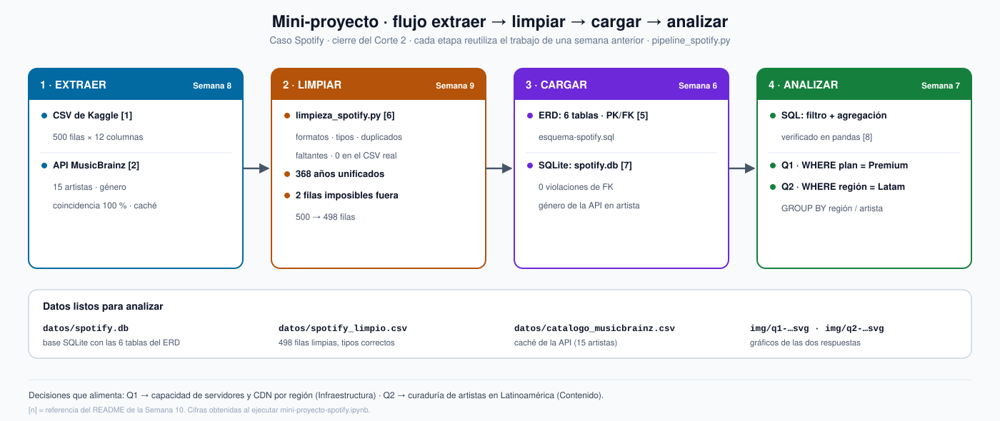
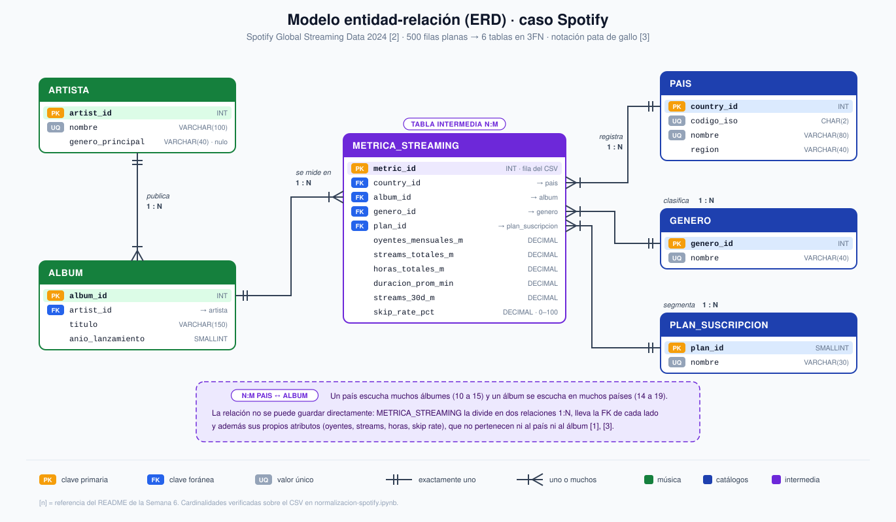
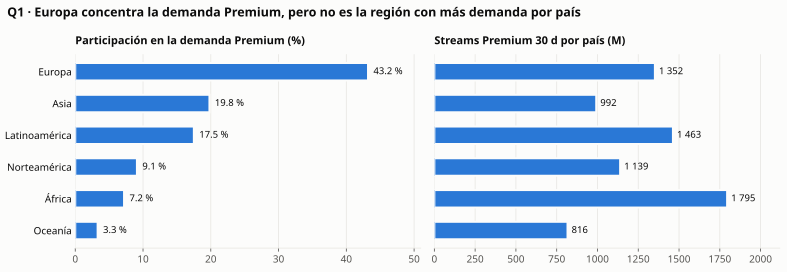
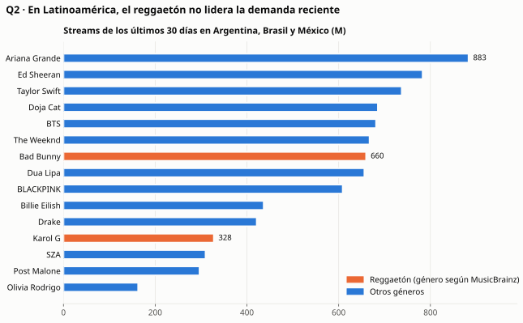

# Semana 10 — Mini-proyecto de datos (cierre del Corte 2)

**Programa:** Ingeniería Industrial · **Asignatura:** Ciencia de Datos
**Unidad 2:** Modelamiento, transformación y conexión de datos · **Corte 2 · Semana 10** · **Periodo:** 2026-B
**Modalidad:** Individual/parejas · **Tipo:** Formativa (sin nota)

**Julián Andrés Solano Ledesma**

> Cierre del caso **Spotify — capacidad de streaming y curaduría regional** para el Corte 2. El mini-proyecto integra en un solo flujo reproducible todo lo construido en la unidad:
>
> - el **modelo de datos** de la Semana 6;
> - la **carga** del dataset de Kaggle [1] y de la API de MusicBrainz [2] de la Semana 8;
> - la **limpieza** en pandas de la Semana 9;
> - las **consultas** con filtro y agregación de la Semana 7.
>
> El resultado son datos listos para analizar y dos preguntas de negocio respondidas.

---

## 1. Flujo del mini-proyecto

El Corte 2 recorre cuatro temas: modelamiento, herramientas de consulta, conexión de datos (APIs, ETL y pipelines) y calidad de datos [3]. Este mini-proyecto los encadena en el orden en que trabaja un proceso ETL: **extraer** de las fuentes, **transformar** (limpiar) y **cargar** en el almacén donde se analiza [4].



*Fig. 1. Flujo del mini-proyecto. Diagrama generado con asistencia de inteligencia artificial (Claude, Anthropic), a partir del pipeline de este documento.*

| Etapa | Qué hace | Código | Reutiliza | Resultado |
|---|---|---|---|---|
| **1. Extraer** | Lee el CSV de Kaggle y consulta el género de cada artista en la API | `extraer_csv()`, `extraer_api()` | Semana 8 | 500 filas + 15 artistas |
| **2. Limpiar** | Formatos, tipos, duplicados, faltantes, año por álbum y valores imposibles | `limpiar()`, que llama a `limpieza_spotify.py` | Semana 9 | 498 filas limpias |
| **3. Cargar** | Lleva la tabla limpia a las 6 tablas del ERD y las carga en SQLite con PK, FK y `CHECK` | `modelar()`, `cargar()` | Semana 6 | `datos/spotify.db` |
| **4. Analizar** | Dos consultas SQL con filtro y agregación, verificadas en pandas | `consultas-mini-proyecto.sql` | Semana 7 | Q1 y Q2 |

Todo el flujo corre con un solo comando, `python pipeline_spotify.py`, desde [`pipeline_spotify.py`](./pipeline_spotify.py). El cuaderno [`mini-proyecto-spotify.ipynb`](./mini-proyecto-spotify.ipynb) lo ejecuta y muestra la evidencia de cada etapa. Ninguna etapa duplica código: la limpieza se importa del script de la Semana 9, y el esquema y los catálogos se leen de la Semana 6.

---

## 2. Modelo de datos

El modelo es el ERD de la [Semana 6](../../06-week/02-optional-activity/README.md). Tiene 6 entidades con sus PK y FK, y la relación N:M entre país y álbum se resuelve con la tabla intermedia `METRICA_STREAMING`. Un ERD describe el dominio con entidades, atributos y relaciones [5], y aquí sirve como contrato: los datos solo entran a la base si respetan sus claves y restricciones.



*Fig. 2. ERD del caso (Semana 6).*

**Lo nuevo en el modelo:** la columna `artista.genero_principal`, que estaba vacía desde la Semana 6 porque el CSV no asigna un género único por artista, ahora se llena con la API de MusicBrainz para los 15 artistas.

---

## 3. Carga y limpieza

### 3.1 Extraer: CSV + API

- **CSV de Kaggle [1]:** 500 filas × 12 columnas, leídas como texto. La conversión de tipos es parte de la limpieza.
- **API de MusicBrainz [2]:** para cada artista se busca su identificador y se pide el género con más votos de la comunidad. Las 15 búsquedas coinciden al 100 %. El resultado se guarda en una **caché** (`datos/catalogo_musicbrainz.csv`), así el flujo se puede repetir sin depender de la red. `python pipeline_spotify.py --api` vuelve a consultarla.

| Género (MusicBrainz) | Artistas |
|---|---|
| pop | Ariana Grande, Ed Sheeran, Olivia Rodrigo, Taylor Swift |
| hip hop | Doja Cat, Drake, Post Malone |
| k-pop | BLACKPINK, BTS |
| reggaeton | Bad Bunny, KAROL G |
| r&b · contemporary r&b | The Weeknd · SZA |
| dance-pop · electropop | Dua Lipa · Billie Eilish |

### 3.2 Limpiar: el script de la Semana 9 sobre los datos reales

La limpieza ataca los problemas típicos que dejan un dato mal registrado: faltantes, duplicados, formatos inconsistentes y valores imposibles [6]. Se aplicaron los mismos 7 pasos de la Semana 9, esta vez sobre el CSV **original**, sin ensuciar. Por eso varios pasos no encuentran nada que corregir, y eso también es evidencia: el archivo no tiene nulos, duplicados ni problemas de formato.

| Paso | Dimensión | Resultado sobre el CSV real |
|---|---|---|
| 1. Nombres de columna | Consistencia | 12 columnas a snake_case, iguales al modelo |
| 2. Formato de texto | Consistencia | 0 celdas por corregir; todos los valores están en el catálogo |
| 3. Tipos | Exactitud | 6 medidas a `float64` y el año a `Int16` |
| 4. Duplicados | Unicidad | 0 filas repetidas |
| 5. Faltantes | Completitud | 0 nulos; nada que eliminar ni imputar |
| 6. Año por álbum | Consistencia | **368 celdas** unificadas a un año por álbum |
| 7. Valores imposibles | Exactitud | **2 filas** eliminadas (streams de 30 días mayores que los totales) |

| Indicador | Antes | Después |
|---|---:|---:|
| Filas | 500 | **498** |
| Celdas nulas | 0 | 0 |
| Duplicados exactos | 0 | 0 |
| Álbumes con más de un año de lanzamiento | 15 | **0** |
| Filas imposibles (streams 30 d > totales) | 2 | **0** |

### 3.3 Cargar: las 6 tablas del ERD en SQLite

La tabla limpia se separa en las tablas del modelo, con los **mismos id de la Semana 6**, y se carga en una base SQLite [7] creada con [`esquema-spotify.sql`](../../06-week/02-optional-activity/esquema-spotify.sql).

| Tabla | Filas |
|---|---:|
| `pais` | 20 |
| `genero` | 10 |
| `plan_suscripcion` | 2 |
| `artista` | 15 (con `genero_principal` de la API) |
| `album` | 15 |
| `metrica_streaming` | 498 |

`PRAGMA foreign_key_check` reporta **0 violaciones**. Además, el pipeline comprueba que el año de lanzamiento de cada álbum coincide con el del catálogo de la Semana 6, así que las dos semanas cuentan la misma historia.

---

## 4. Dos análisis con consultas

Las consultas están en [`consultas-mini-proyecto.sql`](./consultas-mini-proyecto.sql). Cada una combina un **filtro** (`WHERE`) con una **agregación** (`GROUP BY`). El cuaderno las ejecuta sobre `spotify.db` y las reproduce en pandas [8]: los resultados coinciden, con una tolerancia de 0,01 porque SQLite y pandas redondean distinto los valores terminados en 5. Los gráficos se hicieron con Matplotlib [9].

### Q1 · Capacidad: ¿qué regiones concentran la demanda Premium de los últimos 30 días?

```sql
SELECT p.region,
       COUNT(DISTINCT p.country_id)                                        AS paises,
       ROUND(SUM(m.streams_30d_m), 2)                                      AS streams_30d_total_m,
       ROUND(100.0 * SUM(m.streams_30d_m) / SUM(SUM(m.streams_30d_m)) OVER (), 1) AS participacion_pct,
       ROUND(SUM(m.streams_30d_m) / COUNT(DISTINCT p.country_id), 2)       AS streams_30d_por_pais_m
FROM   metrica_streaming m
JOIN   pais p             ON p.country_id = m.country_id
JOIN   plan_suscripcion ps ON ps.plan_id  = m.plan_id
WHERE  ps.nombre = 'Premium'                       -- filtro
GROUP  BY p.region                                 -- agregación
ORDER  BY streams_30d_total_m DESC;
```

| Región | Países | Streams Premium 30 d (M) | Participación | Por país (M) |
|---|---:|---:|---:|---:|
| Europa | 8 | 10 815,88 | **43,2 %** | 1 351,98 |
| Asia | 5 | 4 961,87 | 19,8 % | 992,37 |
| Latinoamérica | 3 | 4 387,74 | 17,5 % | 1 462,58 |
| Norteamérica | 2 | 2 277,67 | 9,1 % | 1 138,84 |
| África | 1 | 1 794,71 | 7,2 % | **1 794,71** |
| Oceanía | 1 | 816,32 | 3,3 % | 816,32 |



*Fig. 3. Q1. A la izquierda, la participación de cada región; a la derecha, los streams Premium por país. Son dos gráficos separados porque las medidas tienen escalas distintas.*

**Lectura:**

- **Europa** concentra el **43,2 %** de la demanda Premium reciente. Es la región prioritaria para nodos de CDN de alcance regional.
- Esa ventaja viene de que reúne **8 de los 20 países**. Medida **por país**, la demanda más alta está en **África**, que en el dataset es solo South Africa (1 794,71 M), y en **Latinoamérica** (1 462,58 M).

**Decisión para Infraestructura:** dimensionar la capacidad por región y también por país. El total regional orienta dónde poner los nodos; la carga por país señala los servidores que más presión reciben. Planear solo con los totales dejaría corto a South Africa y a los tres mercados latinoamericanos.

### Q2 · Curaduría: en Latinoamérica, ¿qué artistas acumulan más demanda reciente?

```sql
SELECT ar.nombre                      AS artista,
       ar.genero_principal            AS genero_musicbrainz,   -- dato de la API
       COUNT(*)                       AS registros,
       ROUND(SUM(m.streams_30d_m), 2) AS streams_30d_total_m,
       ROUND(AVG(m.skip_rate_pct), 2) AS skip_rate_prom_pct
FROM   metrica_streaming m
JOIN   pais    p  ON p.country_id = m.country_id
JOIN   album   al ON al.album_id  = m.album_id
JOIN   artista ar ON ar.artist_id = al.artist_id
WHERE  p.region = 'Latinoamérica'                 -- filtro: Argentina, Brasil y México
GROUP  BY ar.nombre, ar.genero_principal          -- agregación
ORDER  BY streams_30d_total_m DESC;
```

| # | Artista | Género (MusicBrainz) | Streams 30 d (M) | Skip prom. |
|---:|---|---|---:|---:|
| 1 | Ariana Grande | pop | **883,21** | 20,27 % |
| 2 | Ed Sheeran | pop | 783,15 | 21,20 % |
| 3 | Taylor Swift | pop | 737,60 | **14,44 %** |
| 4 | Doja Cat | hip hop | 685,51 | 27,13 % |
| 5 | BTS | k-pop | 681,60 | 19,17 % |
| 6 | The Weeknd | r&b | 667,41 | **13,44 %** |
| 7 | **Bad Bunny** | **reggaeton** | 659,88 | 23,70 % |
| 12 | **Karol G** | **reggaeton** | 327,92 | 15,74 % |

*(Tabla completa de los 15 artistas en el cuaderno).*



*Fig. 4. Q2. En naranja, los artistas a quienes MusicBrainz asigna reggaetón como género principal.*

**Lectura:**

- En los tres mercados latinoamericanos lidera **Ariana Grande** (883,21 M), seguida de Ed Sheeran y Taylor Swift.
- Los dos artistas de **reggaetón**, según MusicBrainz, no encabezan la demanda reciente: **Bad Bunny es 7.º y Karol G, 12.º**.
- **Taylor Swift** y **The Weeknd** combinan alta demanda con el menor abandono (14,44 % y 13,44 %).

**Decisión para Contenido:** en Latinoamérica conviene priorizar a Taylor Swift y The Weeknd en playlists y campañas, porque tienen mucha demanda y poco abandono. Asumir que el reggaetón domina la región sin revisar los datos llevaría a una curaduría equivocada para este dataset.

---

## 5. Datos listos para analizar

| Archivo | Contenido |
|---|---|
| `datos/spotify.db` | Base SQLite con las 6 tablas del ERD, PK, FK y `CHECK`: lista para nuevas consultas |
| `datos/spotify_limpio.csv` | Tabla limpia (498 filas, tipos correctos) para quien prefiera pandas |
| `datos/catalogo_musicbrainz.csv` | Caché de la API: MBID, tipo, país y género de los 15 artistas |
| `img/*.svg` | Gráficos de Q1 y Q2 |

**Estructura de la entrega**

```
10-week/02-optional-activity/
├── README.md                      ← este documento
├── diagrama-flujo.svg             ← Fig. 1: extraer → limpiar → cargar → analizar
├── pipeline_spotify.py            ← flujo completo (usa la limpieza de la Semana 9 y el esquema de la Semana 6)
├── consultas-mini-proyecto.sql    ← Q1 y Q2 (filtro + agregación)
├── mini-proyecto-spotify.ipynb    ← evidencia de cada etapa, verificación en pandas y gráficos
├── datos/                         ← spotify.db, spotify_limpio.csv, catalogo_musicbrainz.csv
└── img/                           ← q1-demanda-premium-region.svg, q2-artistas-latinoamerica.svg
```

**Cómo reproducirlo** (desde esta carpeta del repositorio):

```bash
pip install pandas requests matplotlib jupyter
python pipeline_spotify.py                 # extraer -> limpiar -> cargar (usa la caché de la API)
jupyter notebook mini-proyecto-spotify.ipynb   # análisis y gráficos
```

---

## 6. Limitaciones

- El dataset [1] tiene 500 filas **agregadas** y un número desigual de registros por país y artista (entre 2 y 8 por artista en Latinoamérica). Las sumas reflejan también cuántos registros hay de cada uno, no solo la demanda real.
- Como ya se vio en la Semana 6, los géneros y años del CSV no siempre corresponden a la realidad. Por eso Q2 usa el género de MusicBrainz, que sí describe al artista. Aun así, las conclusiones son indicativas y no deben leerse como una medición del mercado.
- El año de lanzamiento se unificó con una regla (el más frecuente), no con una fuente verificada.

---

## 7. Referencias (formato IEEE)

[1] A. Soundankar, "Spotify Global Streaming Data (2024)," Kaggle, 2024. [Online]. Disponible: https://www.kaggle.com/datasets/atharvasoundankar/spotify-global-streaming-data-2024

[2] A. Swartz, "MusicBrainz: A semantic Web service," *IEEE Intelligent Systems*, vol. 17, no. 1, pp. 76–77, 2002, doi: 10.1109/5254.988466.

[3] Corporación Universitaria del Huila (CORHUILA), "Ciencia de Datos · Semana 10 · Repaso y evaluación del Corte 2," Objeto Virtual de Aprendizaje (OVA), Neiva, Colombia, 2026. [Online]. Disponible: https://code-corhuila.github.io/ova-web/2026-B/ciencia-datos/10-week/01-session/

[4] P. Vassiliadis, "A survey of extract–transform–load technology," *International Journal of Data Warehousing and Mining*, vol. 5, no. 3, pp. 1–27, 2009, doi: 10.4018/jdwm.2009070101.

[5] P. P.-S. Chen, "The entity-relationship model—Toward a unified view of data," *ACM Transactions on Database Systems*, vol. 1, no. 1, pp. 9–36, 1976, doi: 10.1145/320434.320440.

[6] E. Rahm and H. H. Do, "Data cleaning: Problems and current approaches," *IEEE Data Engineering Bulletin*, vol. 23, no. 4, pp. 3–13, 2000. [Online]. Disponible: https://old.dbs.uni-leipzig.de/file/TBDE2000.pdf

[7] K. P. Gaffney, M. Prammer, L. Brasfield, D. R. Hipp, D. Kennedy, and J. M. Patel, "SQLite: Past, present, and future," *Proceedings of the VLDB Endowment*, vol. 15, no. 12, pp. 3535–3547, 2022, doi: 10.14778/3554821.3554842.

[8] W. McKinney, "Data structures for statistical computing in Python," in *Proc. 9th Python in Science Conf. (SciPy)*, Austin, TX, USA, 2010, pp. 56–61, doi: 10.25080/Majora-92bf1922-00a.

[9] J. D. Hunter, "Matplotlib: A 2D graphics environment," *Computing in Science & Engineering*, vol. 9, no. 3, pp. 90–95, 2007, doi: 10.1109/MCSE.2007.55.
