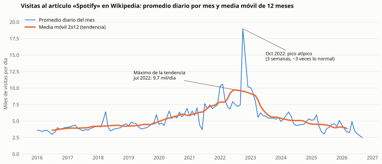
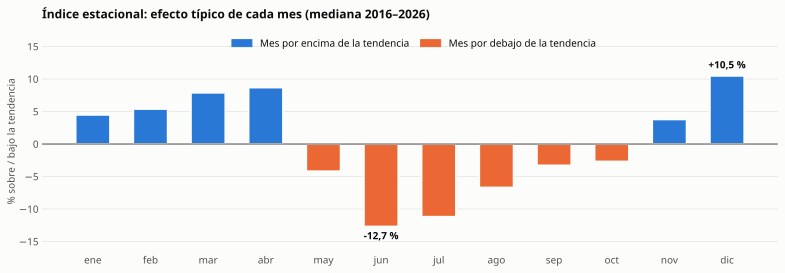

# Semana 11 — Análisis de una serie de tiempo

**Programa:** Ingeniería Industrial · **Asignatura:** Ciencia de Datos
**Unidad 3:** Análisis temporal, visualización y optimización · **Corte 3 · Semana 11** · **Periodo:** 2026-B
**Modalidad:** Individual/parejas · **Tipo:** Formativa (sin nota)

**Julián Andrés Solano Ledesma**

> Continuación del caso **Spotify — capacidad de streaming y curaduría regional**. La pregunta de negocio planteada desde el Corte 1 pide saber *en qué momentos del año aumentará la demanda*, y para responderla hace falta una **serie de tiempo**. Aquí se carga una serie diaria real en pandas, con la fecha como índice. Se agrega por mes con `resample`, se calcula una media móvil con `rolling`, y se describen su tendencia y su estacionalidad.

---

## 1. La serie: interés diario en Spotify

El dataset de Kaggle de las semanas anteriores [3] no tiene fechas: es una foto agregada de 2024. Por eso la dimensión temporal se toma de una fuente **real y pública**: las **visitas diarias al artículo "Spotify" de Wikipedia en inglés**, que publica la API de páginas vistas de Wikimedia [2]. Como la API de la Semana 8, responde en JSON y no requiere clave.

| Atributo | Valor |
|---|---|
| Fuente | API de páginas vistas de Wikimedia [2], artículo *Spotify*, `en.wikipedia` |
| Tráfico | Solo usuarios (`agent=user`), sin bots identificados; todos los accesos (web y app) |
| Periodo | 1 de enero de 2016 – 30 de septiembre de 2026 |
| Tamaño | **3 926 días**, sin nulos ni días faltantes |
| Caché | `datos/pageviews_spotify_diario.csv`, para repetir el análisis sin red |

**¿Por qué sirve como aproximación de la demanda?** La actividad en Wikipedia refleja el interés del público por un tema, y se ha usado para anticipar fenómenos reales. Por ejemplo, permitió predecir el éxito de taquilla de películas antes de su estreno [4] y seguir en tiempo real la evolución de enfermedades [5]. Aquí las visitas miden **atención sobre Spotify**, no reproducciones; esa diferencia se discute en la sección 5.

---

## 2. Script: fecha como índice, `resample` y `rolling`

El código está en [`serie_tiempo_spotify.py`](./serie_tiempo_spotify.py). El cuaderno [`serie-tiempo-spotify.ipynb`](./serie-tiempo-spotify.ipynb) lo ejecuta y genera las tablas y los gráficos con pandas [7] y Matplotlib [8].

```python
# 1. Carga: el texto "20160101..." se convierte en fecha y pasa a ser el índice
serie = pd.DataFrame({
    "fecha":   pd.to_datetime(items["timestamp"].str[:8], format="%Y%m%d"),
    "visitas": items["views"].astype("int64"),
})
diaria = serie.set_index("fecha")["visitas"]                  # DatetimeIndex

# 2. Agregación por mes (resample)
mensual_total = diaria.resample("MS").sum()                    # visitas del mes
mensual_prom  = diaria.resample("MS").mean()                   # promedio diario del mes

# 3. Media móvil de 12 meses, centrada (rolling)
tendencia = mensual_prom.rolling(12).mean().rolling(2).mean().shift(-6)
```

**Tres decisiones del script:**

1. **La fecha se convierte a `datetime` y pasa a ser el índice.** Analizar la fecha como texto impide agregar y ordenar por periodo, un error común [1].
2. **Se analiza el promedio diario de cada mes, no solo la suma.** Febrero tiene 28 días y julio 31, así que con la suma febrero parecería un mes "flojo" solo por tener menos días. El promedio diario elimina ese efecto de calendario. La suma mensual también queda en la tabla.
3. **La media móvil es de 12 meses y está centrada (2×12).** Una ventana de 12 meses abarca un año completo, así que los meses altos y bajos se compensan y queda solo la **tendencia** [6]. Como 12 es par, se promedian dos medias de 12 consecutivas para que cada valor quede centrado en un mes exacto, y no medio mes desplazado [6]. Por eso faltan 6 meses al inicio y 6 al final.

| Mes | Visitas del mes | Promedio diario | Media móvil 2×12 |
|---|---:|---:|---:|
| oct 2025 | 142 339 | 4 591,6 | 3 996,6 |
| nov 2025 | 126 074 | 4 202,5 | 4 023,5 |
| dic 2025 | 158 198 | **5 103,2** | 4 109,5 |
| ene 2026 | 135 676 | 4 376,6 | 4 097,2 |
| feb 2026 | 105 667 | 3 773,8 | 4 012,9 |
| mar 2026 | 104 094 | 3 357,9 | 3 877,4 |

*Últimos meses con tendencia calculada. La tabla completa de 129 meses está en el cuaderno.*

---

## 3. Gráfico de la serie con su media móvil



*Fig. 1. Promedio diario de visitas por mes (azul) y media móvil centrada de 12 meses (naranja), 2016–2026.*

---

## 4. Tendencia y estacionalidad

> **En síntesis:** la **tendencia** sube de unas 3,6 mil visitas diarias en 2016 a un máximo de 9,7 mil a mediados de 2022, y luego baja hasta unas 3,9 mil en 2026, cerca del nivel de 2016–2017. La **estacionalidad** es anual y muy regular: el interés es mayor de **noviembre a abril**, con su punto más alto en **diciembre (+10,5 %)**, y menor de **mayo a octubre**, con su punto más bajo en **junio (−12,7 %)**.

### 4.1 Tendencia

| Año | Promedio diario | Mediana diaria |
|---|---:|---:|
| 2016 | 3 592 | 3 535 |
| 2018 | 4 332 | 4 060 |
| 2020 | 5 603 | 5 397 |
| **2022** | **9 736** | **7 758** |
| 2024 | 5 072 | 4 834 |
| 2026 (ene–sep) | 3 516 | 3 292 |

El crecimiento es sostenido entre 2016 y 2022, y le sigue un descenso igual de marcado. El máximo de 2022 **no es solo efecto del pico atípico de octubre** (sección 4.3). La **mediana** diaria, que ese pico no altera, también alcanza su valor más alto en 2022.

### 4.2 Estacionalidad

Para medir el efecto de cada mes se dividió el promedio diario entre su tendencia. Luego se tomó la **mediana** de cada mes del calendario a lo largo de los años: es el *índice estacional* de la descomposición clásica [6], en una versión robusta a meses atípicos.



*Fig. 2. Efecto típico de cada mes respecto de la tendencia (mediana 2016–2026).*

| Mes | Efecto típico | Años por encima de la tendencia |
|---|---:|---:|
| **dic** | **+10,5 %** | 8 de 10 |
| abr | +8,7 % | 6 de 9 |
| mar | +7,9 % | 6 de 10 |
| **jun** | **−12,7 %** | **0 de 9** |
| jul | −11,2 % | 2 de 10 |
| **ago** | −6,7 % | **0 de 10** |

**El patrón se repite año tras año, así que no es un promedio engañoso:**

- **Agosto** estuvo por debajo de su tendencia en los **10 años** medidos, y **junio** en los **9**.
- **Diciembre** estuvo por encima en 8 de 10.
- Dentro de diciembre, el día con más visitas cayó entre el **27 de noviembre y el 7 de diciembre en 9 de los 10 años**. Es un pico concentrado en la primera semana del mes, no un aumento repartido.

Estos datos no permiten establecer *por qué* ocurre ese pico; queda como hipótesis por contrastar con el calendario de campañas de la empresa.

### 4.3 Picos que no son estacionalidad

Del 13 de octubre al 5 de noviembre de 2022, las visitas se mantuvieron en una mediana de **3,3 veces** la de septiembre. Es un evento puntual de un solo año: no se repite en ningún otro octubre, y la serie no permite identificar su causa. Si el índice estacional se calculara con la media y no con la mediana, este pico haría que octubre pareciera un mes alto, cuando en 6 de 10 años estuvo **por debajo** de su tendencia. Es justamente la razón para usar la mediana.

### 4.4 Qué significa para el caso

- **Capacidad:** los meses de mayor interés (noviembre–abril, sobre todo la primera semana de diciembre) son los candidatos a anticipar con capacidad extra de servidores y CDN. La caída típica de **junio a agosto** es la mejor ventana para mantenimientos y migraciones.
- **Siguiente paso: pronóstico.** Con la tendencia y la estacionalidad separadas se puede proyectar la serie [1]. Modelos como Prophet combinan exactamente esos componentes y entregan intervalos de incertidumbre [9]. Ese pronóstico debe evaluarse con meses que el modelo no haya visto [1].

---

## 5. Limitaciones

- **Atención no es uso.** Las visitas a Wikipedia miden interés por Spotify, no reproducciones ni carga real en los servidores [4], [5]. Para planear capacidad habría que validar el patrón con datos internos de streaming.
- **Audiencia de Wikipedia en inglés.** La estacionalidad (meses bajos de junio a agosto) puede reflejar el calendario del hemisferio norte, que domina esa audiencia. No necesariamente se cumple en mercados como Latinoamérica.
- **La caída desde 2023** puede deberse a cambios en cómo se busca información en internet, y no a un menor uso de Spotify. La serie por sí sola no permite separar esas causas.
- **Los extremos de la media móvil** se pierden: 6 meses al inicio y 6 al final no tienen tendencia calculada.

---

## 6. Archivos de la entrega

```
11-week/02-optional-activity/
├── README.md                         ← este documento
├── serie_tiempo_spotify.py           ← carga (API + caché), resample, media móvil 2x12 e índice estacional
├── serie-tiempo-spotify.ipynb        ← ejecución, tablas, comprobación año a año y gráficos
├── datos/pageviews_spotify_diario.csv ← serie diaria (3 926 días)
└── img/
    ├── serie-media-movil.svg         ← Fig. 1
    └── indice-estacional.svg         ← Fig. 2
```

**Cómo reproducirlo** (desde esta carpeta):

```bash
pip install pandas requests matplotlib jupyter
python serie_tiempo_spotify.py          # usa la caché; con --api vuelve a descargar
jupyter notebook serie-tiempo-spotify.ipynb
```

---

## 7. Referencias (formato IEEE)

[1] Corporación Universitaria del Huila (CORHUILA), "Ciencia de Datos · Semana 11 · Análisis temporal y series de tiempo," Objeto Virtual de Aprendizaje (OVA), Neiva, Colombia, 2026. [Online]. Disponible: https://code-corhuila.github.io/ova-web/2026-B/ciencia-datos/11-week/01-session/

[2] Wikimedia Foundation, "Wikimedia REST API: Pageviews per article," 2026. [Online]. Disponible: https://wikimedia.org/api/rest_v1/ (consultado: 12 oct. 2026).

[3] A. Soundankar, "Spotify Global Streaming Data (2024)," Kaggle, 2024. [Online]. Disponible: https://www.kaggle.com/datasets/atharvasoundankar/spotify-global-streaming-data-2024

[4] M. Mestyán, T. Yasseri, and J. Kertész, "Early prediction of movie box office success based on Wikipedia activity big data," *PLoS ONE*, vol. 8, no. 8, Art. no. e71226, 2013, doi: 10.1371/journal.pone.0071226.

[5] N. Generous, G. Fairchild, A. Deshpande, S. Y. Del Valle, and R. Priedhorsky, "Global disease monitoring and forecasting with Wikipedia," *PLoS Computational Biology*, vol. 10, no. 11, Art. no. e1003892, 2014, doi: 10.1371/journal.pcbi.1003892.

[6] R. J. Hyndman and G. Athanasopoulos, *Forecasting: Principles and Practice*, 3rd ed. Melbourne, Australia: OTexts, 2021, cap. 3, "Time series decomposition." [Online]. Disponible: https://otexts.com/fpp3/

[7] W. McKinney, "Data structures for statistical computing in Python," in *Proc. 9th Python in Science Conf. (SciPy)*, Austin, TX, USA, 2010, pp. 56–61, doi: 10.25080/Majora-92bf1922-00a.

[8] J. D. Hunter, "Matplotlib: A 2D graphics environment," *Computing in Science & Engineering*, vol. 9, no. 3, pp. 90–95, 2007, doi: 10.1109/MCSE.2007.55.

[9] S. J. Taylor and B. Letham, "Forecasting at scale," *The American Statistician*, vol. 72, no. 1, pp. 37–45, 2018, doi: 10.1080/00031305.2017.1380080.
