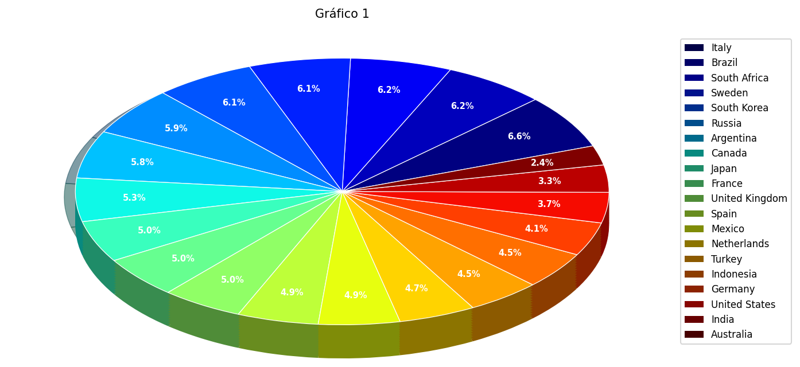
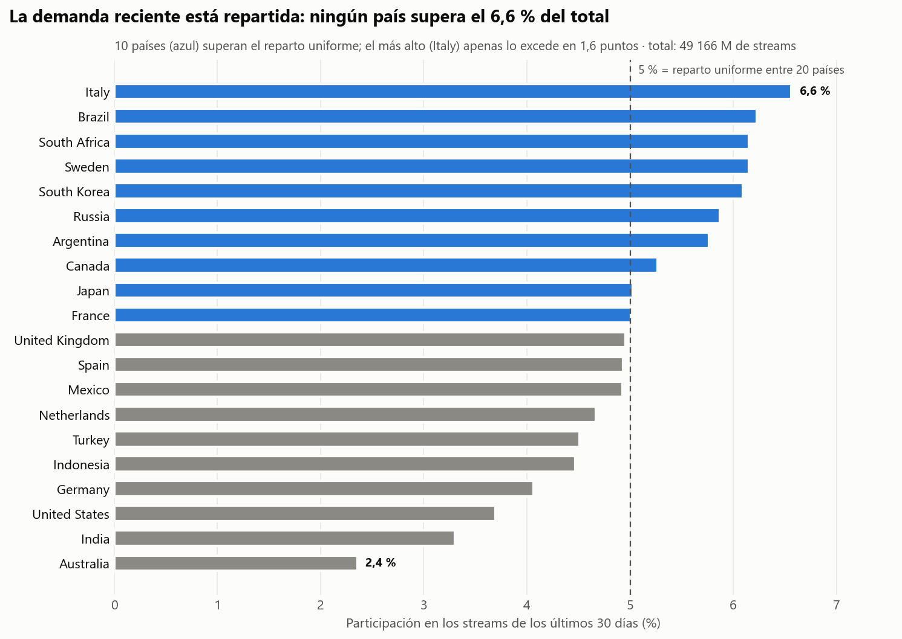
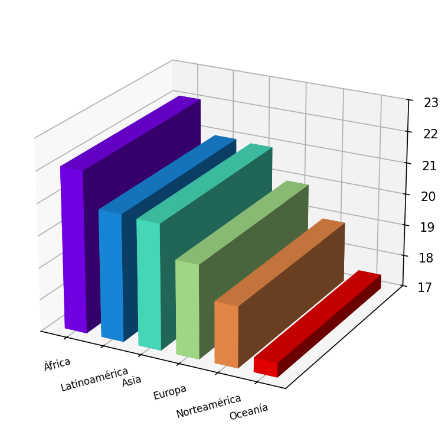
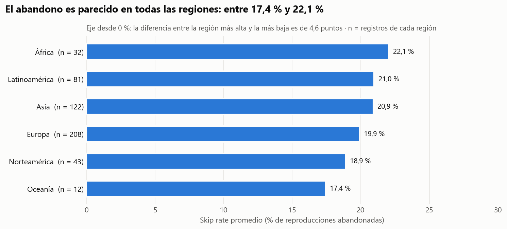

# Semana 12 — Rediseña un gráfico

**Programa:** Ingeniería Industrial · **Asignatura:** Ciencia de Datos
**Unidad 3:** Análisis temporal, visualización y optimización · **Corte 3 · Semana 12** · **Periodo:** 2026-B
**Modalidad:** Individual/parejas · **Tipo:** Formativa (sin nota)

**Julián Andrés Solano Ledesma**

> Continuación del caso **Spotify — capacidad de streaming y curaduría regional**. Se crean dos gráficos mal hechos con los datos del propio caso y se rediseñan con los cuatro principios del OVA: **gráfico correcto, escala honesta, título con conclusión y color con propósito** [1]. Para cada uno se presenta el **diagnóstico** de sus problemas, el **antes y después** y la **justificación** de cada decisión.

---

## 1. Qué se rediseñó

Los dos gráficos usan la base limpia del [mini-proyecto de la Semana 10](../../10-week/02-optional-activity/README.md) (`spotify.db`, 498 registros del dataset de Kaggle [2]). Los gráficos "antes" se construyeron **mal a propósito**, con los errores más comunes que señala el OVA: tortas saturadas, efecto 3D, ejes truncados y gráficos sin título [1]. Todo se genera con [`rediseno_graficos.py`](./rediseno_graficos.py), usando Matplotlib [3].

| Caso | Pregunta | Antes | Después |
|---|---|---|---|
| **A** | ¿Cómo se reparte la demanda reciente entre los 20 países? | Torta 3D con 20 porciones y arcoíris | Barras horizontales ordenadas, con referencia del 5 % |
| **B** | ¿Qué región abandona más las canciones (*skip rate*)? | Barras 3D con el eje truncado en 17 % | Barras desde 0 % con el valor y el tamaño de muestra |

---

## 2. Caso A · Participación de cada país en la demanda

### Antes



*Fig. 1. Caso A, antes: torta 3D con 20 porciones, construida mal a propósito. Elaboración propia con datos de [2], graficado con Matplotlib [3].*

### Diagnóstico

| # | Problema | Principio que incumple | Evidencia en el gráfico |
|---:|---|---|---|
| 1 | **Torta con 20 porciones** para comparar países | Gráfico correcto | La torta solo sirve con pocas categorías [1]. El ojo compara ángulos y áreas con mucha menos precisión que posiciones sobre una escala común [4]: porciones de 6,1 % y 6,2 % se ven iguales. |
| 2 | **Efecto 3D e inclinación** | Escala honesta | La perspectiva agranda las porciones del frente y achica las del fondo, y el "grosor" añade tinta sin datos. Las porciones de 4,9 % del frente se ven más grandes que las de 6,1 % del fondo. El 3D puede reducir la precisión con que se leen los valores [5]. |
| 3 | **Arcoíris de 20 colores** | Color con propósito | El arcoíris no tiene un orden perceptual y crea fronteras artificiales entre tonos [6]. Además, asociar 20 colores con una leyenda lejana es casi imposible: el color decora, no informa. |
| 4 | **Título "Gráfico 1"**, sin unidades, total ni fuente | Título con conclusión | El lector no sabe qué se mide (¿streams?, ¿horas?, ¿de qué periodo?) ni qué debe concluir. El título influye en el mensaje que el lector recuerda [7]. |
| 5 | **Porcentaje en cada porción, sombra y leyenda de 20 entradas** | Menos es más | Gran parte de la tinta no representa datos. La relación datos-tinta debe acercarse a 1 [8]. |

### Después



*Fig. 2. Caso A, después: participación de cada país en los streams de los últimos 30 días. Elaboración propia con datos de [2], graficado con Matplotlib [3].*

### Decisiones de rediseño

| Principio | Decisión |
|---|---|
| **Gráfico correcto** | Barras horizontales **ordenadas de mayor a menor**. Las longitudes sobre una escala común son la forma más precisa de comparar [4], y la orientación horizontal deja leer los 20 nombres sin girarlos. |
| **Escala honesta** | Eje desde **0 %**, en 2D, sin perspectiva: la longitud de cada barra es proporcional a su valor. |
| **Título con conclusión** | "La demanda reciente está repartida: ningún país supera el 6,6 % del total". El subtítulo da el dato que lo respalda y el total (49 166 M de streams). |
| **Color con propósito** | Un solo color de énfasis: **azul** para los 10 países que superan el **reparto uniforme (5 % = 100 % ÷ 20)**, y **gris** para los demás. La línea punteada del 5 % da al lector la referencia para juzgar si un valor es alto. |
| **Menos es más** | Sin leyenda, porque el nombre está junto a cada barra, y sin sombras. Solo se etiquetan el máximo (6,6 %) y el mínimo (2,4 %); el eje da el resto [8]. |

### Justificación

La torta 3D ocultaba la conclusión entre 20 colores y ángulos casi iguales. Con barras ordenadas sobre una escala común se ve de inmediato que **la demanda está repartida**: el país más alto apenas supera el reparto uniforme en 1,6 puntos [4]. El color ya no decora, sino que separa los países sobre y bajo la referencia del 5 %. El título dice lo que hay que concluir, en vez de "Gráfico 1" [1], [7]. Para Infraestructura, el mensaje es que la capacidad debe planearse para muchos mercados medianos, no para uno dominante.

---

## 3. Caso B · Abandono promedio (*skip rate*) por región

### Antes



*Fig. 3. Caso B, antes: barras 3D con el eje truncado en 17 %, construidas mal a propósito. Elaboración propia con datos de [2], graficado con Matplotlib [3].*

### Diagnóstico

| # | Problema | Principio que incumple | Evidencia en el gráfico |
|---:|---|---|---|
| 1 | **Eje truncado en 17 %** | Escala honesta | La barra de África parece unas **11 veces** más alta que la de Oceanía, pero los valores reales son 22,1 % y 17,4 %: una diferencia del **26,5 %**. El eje truncado exagera las diferencias que percibe el lector [9]. |
| 2 | **Barras 3D en perspectiva** | Escala honesta | La profundidad y el ángulo de cámara dificultan leer la altura contra el eje, y las barras del fondo se ven distintas a las del frente [5]. |
| 3 | **Arcoíris** en 6 regiones | Color con propósito | Cada región tiene un color distinto sin ningún significado: el color no codifica nada que el eje no diga ya [6]. |
| 4 | **Sin título, sin unidades ni nombre del eje** | Título con conclusión | No se sabe que el eje mide un porcentaje de abandono, ni cuál es el mensaje. |
| 5 | **No muestra el tamaño de muestra** | Etiquetas y unidades | Oceanía tiene solo **12 registros** frente a 208 de Europa. Comparar sus promedios sin saberlo induce a sobreinterpretar. |

**Cuánto miente el gráfico.** Tufte define el **factor de mentira** como el tamaño del efecto que muestra el gráfico dividido entre el tamaño del efecto en los datos. Un gráfico honesto da un valor cercano a 1, y valores fuera de 0,95–1,05 indican una distorsión importante [8].

| | África | Oceanía | Efecto (cambio relativo) |
|---|---:|---:|---:|
| Datos | 22,07 % | 17,45 % | 26,5 % |
| Altura dibujada (desde 17 %) | 5,07 | 0,45 | ≈ 1 030 % |
| **Factor de mentira** | | | **≈ 38,9** |

El gráfico exagera la diferencia **casi 39 veces**. El cálculo está en la función `factor_de_mentira()` del script.

### Después



*Fig. 4. Caso B, después: skip rate promedio por región, con eje desde 0 %. Elaboración propia con datos de [2], graficado con Matplotlib [3].*

### Decisiones de rediseño

| Principio | Decisión |
|---|---|
| **Gráfico correcto** | Barras horizontales **ordenadas**, en 2D: compara 6 categorías con longitudes sobre una escala común [4]. |
| **Escala honesta** | Eje desde **0 %**. Con barras, la longitud debe ser proporcional al valor, así que el eje no puede truncarse [1], [8]. El factor de mentira vuelve a 1. |
| **Título con conclusión** | "El abandono es parecido en todas las regiones: entre 17,4 % y 22,1 %". El subtítulo cuantifica la diferencia: 4,6 puntos. |
| **Color con propósito** | **Un solo color**: las regiones no necesitan colores distintos porque su nombre está junto a la barra. Sin arcoíris [6]. |
| **Etiquetas y unidades** | Nombre del eje con su unidad, el valor al final de cada barra y el **tamaño de muestra (n)** junto a cada región, para que el lector valore la confianza del promedio. |

### Justificación

El gráfico original fabricaba una conclusión falsa, "África abandona muchísimo más que Oceanía", con un factor de mentira de casi 39 causado por el eje truncado y el 3D [5], [8], [9]. Con el eje desde 0 % se ve la verdad: **las seis regiones abandonan entre 17 % y 22 %**. Para el caso, el *skip rate* por región no justifica estrategias de curaduría distintas por continente. El dato de **n** advierte, además, que el valor de Oceanía (12 registros) es el menos confiable.

---

## 4. Verificación de los principios

| Principio del OVA [1] | Caso A · antes | Caso A · después | Caso B · antes | Caso B · después |
|---|:---:|:---:|:---:|:---:|
| Gráfico correcto para la pregunta | ✗ torta de 20 | ✓ barras ordenadas | ✗ barras 3D | ✓ barras 2D ordenadas |
| Escala honesta | ✗ perspectiva 3D | ✓ desde 0 | ✗ truncada (×38,9) | ✓ desde 0 |
| Título con conclusión | ✗ "Gráfico 1" | ✓ | ✗ sin título | ✓ |
| Color con propósito | ✗ arcoíris (20) | ✓ azul = sobre el 5 % | ✗ arcoíris (6) | ✓ un color |
| Etiquetas y unidades | ✗ | ✓ | ✗ | ✓ incluye n |
| Menos es más | ✗ sombras, leyenda | ✓ | ✗ | ✓ |

---

## 5. Archivos de la entrega

```
12-week/02-optional-activity/
├── README.md                 ← este documento: diagnóstico, rediseño y justificación
├── rediseno_graficos.py      ← genera los 4 gráficos y calcula el factor de mentira
└── img/
    ├── A-antes-torta-3d.png
    ├── A-despues-barras.png
    ├── B-antes-barras-3d.png
    └── B-despues-barras.png
```

**Cómo reproducirlo** (desde esta carpeta; lee la base de la Semana 10):

```bash
pip install matplotlib
python rediseno_graficos.py
```

---

## 6. Referencias (formato IEEE)

[1] Corporación Universitaria del Huila (CORHUILA), "Ciencia de Datos · Semana 12 · Visualización de datos," Objeto Virtual de Aprendizaje (OVA), Neiva, Colombia, 2026. [Online]. Disponible: https://code-corhuila.github.io/ova-web/2026-B/ciencia-datos/12-week/01-session/

[2] A. Soundankar, "Spotify Global Streaming Data (2024)," Kaggle, 2024. [Online]. Disponible: https://www.kaggle.com/datasets/atharvasoundankar/spotify-global-streaming-data-2024

[3] J. D. Hunter, "Matplotlib: A 2D graphics environment," *Computing in Science & Engineering*, vol. 9, no. 3, pp. 90–95, 2007, doi: 10.1109/MCSE.2007.55.

[4] W. S. Cleveland and R. McGill, "Graphical perception: Theory, experimentation, and application to the development of graphical methods," *Journal of the American Statistical Association*, vol. 79, no. 387, pp. 531–554, 1984, doi: 10.1080/01621459.1984.10478080.

[5] M. Siegrist, "The use or misuse of three-dimensional graphs to represent lower-dimensional data," *Behaviour & Information Technology*, vol. 15, no. 2, pp. 96–100, 1996, doi: 10.1080/014492996120300.

[6] D. Borland and R. M. Taylor II, "Rainbow color map (still) considered harmful," *IEEE Computer Graphics and Applications*, vol. 27, no. 2, pp. 14–17, 2007, doi: 10.1109/MCG.2007.323435.

[7] H.-K. Kong, Z. Liu, and K. Karahalios, "Frames and slants in titles of visualizations on controversial topics," in *Proc. 2018 CHI Conf. Human Factors in Computing Systems*, Montreal, QC, Canada, 2018, pp. 1–12, doi: 10.1145/3173574.3174012.

[8] E. R. Tufte, *The Visual Display of Quantitative Information*, 2nd ed. Cheshire, CT, USA: Graphics Press, 2001.

[9] A. V. Pandey, K. Rall, M. L. Satterthwaite, O. Nov, and E. Bertini, "How deceptive are deceptive visualizations? An empirical analysis of common distortion techniques," in *Proc. 33rd Annu. ACM Conf. Human Factors in Computing Systems (CHI)*, Seoul, Republic of Korea, 2015, pp. 1469–1478, doi: 10.1145/2702123.2702608.
