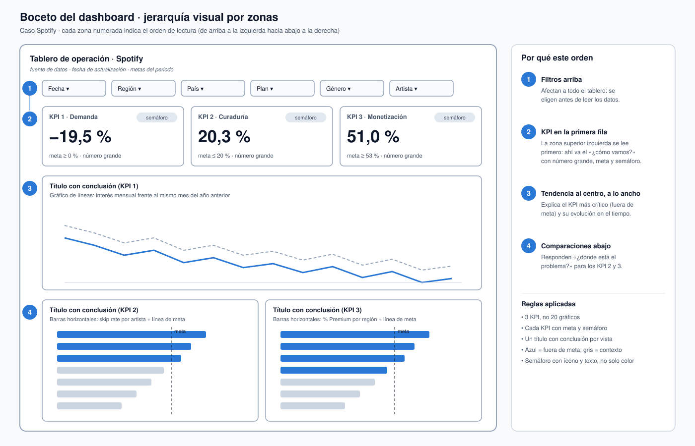
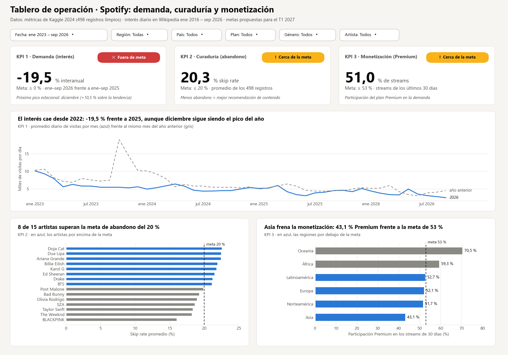

# Semana 13 — Diseña un dashboard

**Programa:** Ingeniería Industrial · **Asignatura:** Ciencia de Datos
**Unidad 3:** Análisis temporal, visualización y optimización · **Corte 3 · Semana 13** · **Periodo:** 2026-B
**Modalidad:** Individual/parejas · **Tipo:** Formativa (sin nota)

**Julián Andrés Solano Ledesma**

> Continuación del caso **Spotify — capacidad de streaming y curaduría regional**. Se diseña el dashboard que usarían los equipos del caso para monitorear el servicio. Se definen 3 KPI con su objetivo, el gráfico que acompaña a cada uno, los filtros del tablero y la justificación de la jerarquía visual. Además del boceto, se construyó un prototipo con los datos reales de las semanas 10 y 11.

---

## 1. Proceso y propósito del tablero

Un dashboard reúne gráficos, KPI y filtros en una sola vista para monitorear un proceso y decidir rápido: responde *¿cómo vamos?* y *¿dónde está el problema?* [1]. Su valor está en que la información clave se pueda leer **de un vistazo** [2]. Por eso es una herramienta de **monitoreo operativo**, distinta de un informe de análisis exploratorio [3].

**Proceso elegido:** la operación del servicio de streaming en 20 mercados. Es el proceso del caso desde el Corte 1, que alimenta dos decisiones: escalar la **capacidad** de servidores y CDN, y priorizar la **curaduría** de contenido por región.

---

## 2. Los 3 KPI y su objetivo

Un KPI mide el desempeño **frente a un objetivo**; un número sin meta no dice si vamos bien o mal [1]. Los tres KPI cubren perspectivas distintas del negocio, como propone el cuadro de mando integral: cliente, procesos internos y resultados financieros [4]. Las metas se escribieron como objetivos **SMART**: específicos, medibles, alcanzables, relevantes y con un plazo definido [5]. Como el caso no trae metas oficiales, se proponen a partir de la línea base de los datos.

| | **KPI 1 · Demanda** | **KPI 2 · Curaduría** | **KPI 3 · Monetización** |
|---|---|---|---|
| **Pregunta** | ¿Crece o cae el interés del público por el servicio? | ¿Qué tan bien retiene el contenido recomendado? | ¿Qué parte de la demanda paga suscripción? |
| **Definición** | Variación del interés de enero a septiembre de 2026 frente al mismo tramo de 2025 | *Skip rate* promedio | % de los streams de los últimos 30 días que viene del plan Premium |
| **Fórmula** | `(Σ interés ene–sep 2026 / Σ interés ene–sep 2025) − 1` | `AVG(skip_rate_pct)` | `Σ streams_30d (Premium) / Σ streams_30d` |
| **Fuente** | Visitas a Wikipedia, Semana 11 [6] | Métricas de Kaggle [7], base de la Semana 10 | Métricas de Kaggle [7], base de la Semana 10 |
| **Línea base** | **−19,5 %** | **20,3 %** | **51,0 %** |
| **Meta SMART (T1 2027)** | ≥ 0 %: frenar la caída interanual | ≤ 20 %: bajar 0,3 puntos | ≥ 53 %: subir 2 puntos |
| **Semáforo** | Verde ≥ 0 · amarillo > −5 % · rojo ≤ −5 % | Verde ≤ 20 · amarillo ≤ 22 · rojo > 22 | Verde ≥ 53 · amarillo ≥ 50 · rojo < 50 |
| **Estado actual** | ✕ Fuera de meta | ! Cerca de la meta | ! Cerca de la meta |
| **Frecuencia** | Mensual | Semanal | Mensual |
| **Decisión que habilita** | Capacidad y presupuesto de infraestructura (Infraestructura) | Ajuste de playlists y recomendaciones (Contenido) | Campañas de conversión a Premium por región (Marketing) |

**Por qué se compara con el mismo tramo del año anterior:** la serie de interés tiene una estacionalidad marcada, con diciembre alto y junio bajo, como mostró la Semana 11. Comparar meses distintos confundiría estacionalidad con tendencia; comparar enero–septiembre contra enero–septiembre la elimina.

---

## 3. Boceto: qué gráfico va con cada KPI y qué filtros tiene



*Fig. 1. Boceto del dashboard con las zonas numeradas en orden de lectura. Elaboración propia.*

### 3.1 Gráfico por KPI

| KPI | Gráfico | Por qué este gráfico |
|---|---|---|
| Todos | **Tarjeta con número grande**, meta y semáforo con ícono y texto | Responde *¿cómo vamos?* de un vistazo [2]. El semáforo lleva ícono y palabra, no solo color. |
| KPI 1 · Demanda | **Líneas**: interés mensual frente al mismo mes del año anterior | La evolución en el tiempo se muestra con líneas [1]. La línea del año anterior da la referencia para leer la variación. |
| KPI 2 · Curaduría | **Barras horizontales**: *skip rate* por artista, con la línea de la meta | Comparar categorías se hace con barras [1]. La línea de meta muestra de inmediato quién la supera. |
| KPI 3 · Monetización | **Barras horizontales**: % Premium por región, con la línea de la meta | Compara 6 regiones contra la meta y señala dónde actuar. |

### 3.2 Filtros

| Filtro | Valores | Afecta a | Para qué sirve |
|---|---|---|---|
| **Fecha** | Rango de meses (ene 2016 – sep 2026) | KPI 1 y su gráfico de tendencia | Elegir el periodo de análisis: temporada alta, último año |
| **Región** | 6 regiones | KPI 2, KPI 3 y sus gráficos | Equivale a la "planta" del enunciado: el mercado que se revisa |
| **País** | 20 países | KPI 2, KPI 3 y sus gráficos | Bajar del nivel regional al país |
| **Plan** | Free · Premium | KPI 2 y su gráfico | Comparar el abandono según el tipo de usuario |
| **Género** | 10 géneros | KPI 2, KPI 3 y sus gráficos | Equivale al "producto": el tipo de contenido |
| **Artista** | 15 artistas | KPI 2, KPI 3 y sus gráficos | Revisar un artista concreto antes de una campaña |

**Limitación de los datos:** las métricas de Kaggle no tienen fechas [7], así que el filtro de fecha solo puede aplicarse a la serie de interés. Con los eventos de reproducción del pipeline de la Semana 8, la fecha filtraría todo el tablero.

### 3.3 Prototipo con datos reales



*Fig. 2. Prototipo del dashboard con los datos del caso. Elaboración propia con datos de [7] y [6], graficado con Matplotlib [8].*

El prototipo se genera con [`dashboard_spotify.py`](./dashboard_spotify.py). Calcula los KPI sobre la base limpia de la Semana 10 y sobre la serie de la Semana 11, y aplica los principios de la Semana 12:

- cada vista tiene un **título con su conclusión**, por ejemplo "8 de 15 artistas superan la meta de abandono del 20 %";
- todas las escalas empiezan en 0;
- el **azul** marca siempre "fuera de meta" y el gris es contexto.

---

## 4. Jerarquía visual: qué va arriba y por qué

El orden sigue la forma en que se lee una pantalla: de arriba a la izquierda hacia abajo a la derecha. Lo más importante va en la **esquina superior izquierda**, la primera zona que mira el usuario [2]. Esta estructura de "números arriba, detalle abajo" es uno de los patrones de diseño más comunes en dashboards [9].

| Zona | Contenido | Por qué en ese lugar |
|---:|---|---|
| **1** | **Filtros** | Afectan a todo el tablero, así que se eligen antes de leer los datos. Si estuvieran abajo, el usuario leería cifras sin saber de qué periodo o mercado son. |
| **2** | **3 tarjetas KPI** con número grande, meta y semáforo | Es la respuesta a *¿cómo vamos?* [1]. El KPI 1 va primero, a la izquierda, porque es el único **fuera de meta** y el que afecta a la decisión más costosa: la capacidad. |
| **3** | **Tendencia del KPI 1**, a todo el ancho | Explica el KPI crítico: muestra que la caída viene desde 2022 y que diciembre sigue siendo el pico. Necesita ancho porque es una serie larga (45 meses). |
| **4** | **Comparaciones del KPI 2 y del KPI 3**, lado a lado | Responden *¿dónde está el problema?* [1]: qué artistas superan el abandono permitido y qué región frena la monetización. Van abajo porque son el detalle que se consulta después de ver el estado general. |

**Reglas que se respetaron** [1], [2]:

- **Pocos KPI relevantes:** 3 en lugar de 20 gráficos, para no saturar.
- **Todo KPI tiene meta:** ningún número aparece sin contexto.
- **Colores con criterio:** el azul siempre significa "fuera de meta" y el gris es contexto. Los colores de estado (verde, amarillo, rojo) se reservan para el semáforo y siempre van con ícono y texto.

---

## 5. Archivos de la entrega

```
13-week/02-optional-activity/
├── README.md                    ← KPI, filtros, gráficos y jerarquía visual
├── dashboard_spotify.py         ← calcula los KPI y genera el prototipo
└── img/
    ├── boceto-dashboard.svg     ← Fig. 1: boceto con zonas y orden de lectura
    └── prototipo-dashboard.png  ← Fig. 2: prototipo con datos reales
```

**Cómo reproducirlo** (desde esta carpeta; lee los datos de las semanas 10 y 11):

```bash
pip install matplotlib
python dashboard_spotify.py
```

---

## 6. Referencias (formato IEEE)

[1] Corporación Universitaria del Huila (CORHUILA), "Ciencia de Datos · Semana 13 · Herramientas de visualización y dashboards," Objeto Virtual de Aprendizaje (OVA), Neiva, Colombia, 2026. [Online]. Disponible: https://code-corhuila.github.io/ova-web/2026-B/ciencia-datos/13-week/01-session/

[2] S. Few, *Information Dashboard Design: Displaying Data for At-a-Glance Monitoring*, 2nd ed. Burlingame, CA, USA: Analytics Press, 2013.

[3] A. Sarikaya, M. Correll, L. Bartram, M. Tory, and D. Fisher, "What do we talk about when we talk about dashboards?," *IEEE Transactions on Visualization and Computer Graphics*, vol. 25, no. 1, pp. 682–692, 2019, doi: 10.1109/TVCG.2018.2864903.

[4] R. S. Kaplan and D. P. Norton, "The balanced scorecard—Measures that drive performance," *Harvard Business Review*, vol. 70, no. 1, pp. 71–79, 1992.

[5] G. T. Doran, "There's a S.M.A.R.T. way to write management's goals and objectives," *Management Review*, vol. 70, no. 11, pp. 35–36, 1981.

[6] Wikimedia Foundation, "Wikimedia REST API: Pageviews per article," 2026. [Online]. Disponible: https://wikimedia.org/api/rest_v1/ (consultado: 12 oct. 2026).

[7] A. Soundankar, "Spotify Global Streaming Data (2024)," Kaggle, 2024. [Online]. Disponible: https://www.kaggle.com/datasets/atharvasoundankar/spotify-global-streaming-data-2024

[8] J. D. Hunter, "Matplotlib: A 2D graphics environment," *Computing in Science & Engineering*, vol. 9, no. 3, pp. 90–95, 2007, doi: 10.1109/MCSE.2007.55.

[9] B. Bach *et al.*, "Dashboard design patterns," *IEEE Transactions on Visualization and Computer Graphics*, vol. 29, no. 1, pp. 342–352, 2023, doi: 10.1109/TVCG.2022.3209448.
