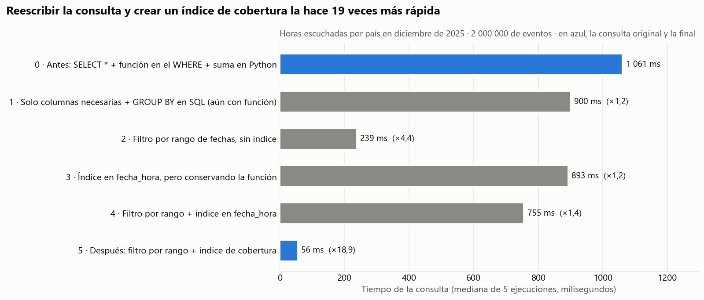

# Semana 14 — Optimiza una consulta (opción A: SQL)

**Programa:** Ingeniería Industrial · **Asignatura:** Ciencia de Datos
**Unidad 3:** Análisis temporal, visualización y optimización · **Corte 3 · Semana 14** · **Periodo:** 2026-B
**Modalidad:** Individual/parejas · **Tipo:** Formativa (sin nota)

**Julián Andrés Solano Ledesma**

> Continuación del caso **Spotify — capacidad de streaming y curaduría regional**. De las dos opciones de la guía se eligió la **opción A (SQL)**. Se toma una consulta lenta del caso, con `SELECT *` y una función sobre la columna en el `WHERE`, y se reescribe con las columnas necesarias, un filtro por rango y un índice. La mejora se **mide**: tiempo, plan de ejecución y comprobación de que el resultado es el mismo.

---

## 1. La consulta y los datos

Optimizar es obtener **el mismo resultado usando menos recursos**. Con pocos datos todo es rápido, pero con millones de filas una consulta mal escrita puede tardar mucho más [1].

**Pregunta de negocio:** *¿cuántas horas se escucharon en cada país en diciembre de 2025?* Diciembre es el mes pico del año (Semana 11), y esta consulta alimenta la decisión de capacidad y la tendencia del KPI 1 del dashboard de la Semana 13.

**Por qué se generó una tabla de eventos.** La base del caso (Semana 10) tiene solo 498 filas agregadas: con tan pocos datos cualquier consulta tarda milisegundos y no se puede medir ninguna mejora. Por eso se construyó la tabla de **eventos de reproducción** que proponía el pipeline de la Semana 8, con **2 000 000 de filas** entre 2024 y 2025. Se generó con semilla fija y **calibrada con datos reales**:

| Columna | Cómo se generó |
|---|---|
| `country_id`, `album_id`, `plan_id` | En proporción a los streams de 30 días de cada combinación del dataset de Kaggle [2] |
| `fecha_hora` | Día en proporción al índice estacional del interés en Wikipedia [3] (Semana 11) y hora al azar. Formato ISO 8601: `AAAA-MM-DD HH:MM:SS` |
| `segundos_escuchados` | Alrededor del 80 % de la duración promedio del álbum en el dataset de Kaggle [2] |
| `dispositivo` | Móvil, escritorio, web, TV o consola |

Diciembre de 2025 tiene **91 684 eventos**, el 4,6 % de la tabla.

---

## 2. Antes y después

### Antes: la consulta lenta

```sql
SELECT *
FROM   reproduccion r
JOIN   pais p ON p.country_id = r.country_id
WHERE  strftime('%Y-%m', r.fecha_hora) = '2025-12';
-- y luego, en Python, se suman los segundos por país fila por fila
```

| Problema | Por qué es lento |
|---|---|
| **`SELECT *`** | Trae las 9 columnas de las dos tablas aunque solo se necesitan 2: más datos leídos y transferidos [1]. |
| **Función sobre la columna en el `WHERE`** | `strftime()` se calcula en las 2 000 000 de filas. Además, el motor no puede usar un índice sobre `fecha_hora`, porque el índice guarda la columna tal cual y no el resultado de la función [1]. |
| **Agregación fuera de la base** | Devuelve 91 684 filas a Python para sumarlas allí, en lugar de devolver las 20 filas del resultado. Traer toda la tabla cuando SQL podía agrupar es un error común de la Semana 7. |

### Después: la consulta optimizada

```sql
CREATE INDEX idx_rep_fecha_cubre
    ON reproduccion (fecha_hora, country_id, segundos_escuchados);

SELECT p.nombre,
       ROUND(SUM(r.segundos_escuchados) / 3600.0, 1) AS horas
FROM   reproduccion r
JOIN   pais p ON p.country_id = r.country_id
WHERE  r.fecha_hora >= '2025-12-01'
  AND  r.fecha_hora <  '2026-01-01'
GROUP  BY p.nombre
ORDER  BY horas DESC;
```

| Cambio | Por qué mejora |
|---|---|
| **Solo las columnas necesarias + `GROUP BY` en SQL** | La base hace la suma y devuelve 20 filas en lugar de 91 684. |
| **Filtro por rango** `>= '2025-12-01' AND < '2026-01-01'` | Compara la columna **sin transformarla**. Es un predicado *sargable* (*search argument*): el optimizador lo puede resolver con un índice [4]. Funciona porque en ISO 8601 el orden del texto coincide con el orden cronológico. El intervalo semiabierto `< 2026-01-01` incluye todo el 31 de diciembre sin importar la hora. |
| **Índice de cobertura** `(fecha_hora, country_id, segundos_escuchados)` | El índice es un árbol B ordenado por fecha: el motor salta al 1 de diciembre y recorre en orden solo ese tramo [5]. Como el índice ya contiene las tres columnas que usa la consulta, la responde **sin leer la tabla** (*plan solo de índice*) [6]. |

Las dos versiones completas están en [`consultas-antes-despues.sql`](./consultas-antes-despues.sql).

---

## 3. Medición: cada mejora por separado

Para no "optimizar sin medir" [1], el script [`optimizacion_sql.py`](./optimizacion_sql.py) ejecuta seis versiones, una por cambio. Cada versión se corre **5 veces** y se toma la mediana. Se guarda el plan de ejecución con `EXPLAIN QUERY PLAN` y se comprueba que **las seis devuelven el mismo resultado**. El motor es SQLite [7].



*Fig. 1. Tiempo de la consulta en cada paso de la optimización (mediana de 5 ejecuciones). Elaboración propia, graficado con Matplotlib [8].*

| Paso | Versión | Tiempo | Mejora | Filas devueltas | Plan de ejecución (tabla de eventos) |
|---:|---|---:|---:|---:|---|
| 0 | **Antes:** `SELECT *` + función + suma en Python | 1 061 ms | — | 91 684 | `SCAN r`: recorre las 2 000 000 de filas |
| 1 | Columnas necesarias + `GROUP BY` (aún con función) | 900 ms | ×1,2 | 20 | `SCAN r` |
| 2 | Filtro por rango, sin índice | 239 ms | ×4,4 | 20 | `SCAN r` |
| 3 | Índice en `fecha_hora`, **pero conservando la función** | 893 ms | ×1,2 | 20 | `SCAN r`: **el índice se ignora** |
| 4 | Filtro por rango + índice simple | 755 ms | ×1,4 | 20 | `SEARCH r USING INDEX` |
| 5 | **Después:** filtro por rango + índice de cobertura | **56 ms** | **×18,9** | 20 | `SEARCH r USING COVERING INDEX` |

*Tiempos medidos en este equipo; en otro equipo los números cambian, pero la proporción entre pasos se mantiene. El detalle está en [`datos/resultados.csv`](./datos/resultados.csv).*

---

## 4. Por qué mejora: lectura de la medición

1. **La función en el `WHERE` anula el índice (paso 3).** Aun con el índice creado, el plan sigue diciendo `SCAN r`, porque el índice está ordenado por `fecha_hora` y no por `strftime('%Y-%m', fecha_hora)`. El optimizador solo puede usar un índice si el predicado compara la columna tal cual [4]. Es la razón principal para reescribir el filtro.

2. **El filtro por rango ayuda incluso sin índice (paso 2: ×4,4).** Sigue recorriendo toda la tabla, pero comparar dos textos es mucho más barato que calcular `strftime()` dos millones de veces.

3. **Un índice simple no siempre basta (paso 4 más lento que el 2).** El índice encuentra rápido las 91 684 filas de diciembre, pero para leer `country_id` y `segundos_escuchados` tiene que saltar a la tabla **una vez por cada fila**. Cuando la consulta toma una parte grande de la tabla, esos saltos pueden costar más que un recorrido secuencial [6]. Por eso el optimizador estima el costo de cada camino antes de elegir [4], [9].

4. **El índice de cobertura elimina esos saltos (paso 5: ×18,9).** Como el índice ya incluye las tres columnas, la consulta se resuelve recorriendo solo el tramo de diciembre del índice [5], [6]. El plan lo confirma: `USING COVERING INDEX`.

**El costo del índice.** El índice ocupa espacio y hace un poco más lentas las inserciones, porque cada evento nuevo también se escribe en él [6]. Vale la pena porque esta tabla se consulta por rango de fechas con mucha frecuencia (dashboard, capacidad) y se escribe por lotes.

---

## 5. Buenas prácticas aplicadas

| Buena práctica [1] | Dónde se aplicó |
|---|---|
| Traer solo las columnas necesarias (evitar `SELECT *`) | `SELECT p.nombre, SUM(...)` |
| Filtrar temprano, en la base, y agregar en SQL | `WHERE` + `GROUP BY` en lugar de sumar en Python |
| No aplicar funciones sobre la columna filtrada | `strftime()` reemplazado por un rango de fechas |
| Indexar las columnas de búsqueda | Índice de cobertura que empieza por `fecha_hora` |
| Medir antes y después | 6 versiones × 5 ejecuciones, plan de ejecución y resultado verificado |

**Impacto en el caso:** con la versión optimizada, el tablero de la Semana 13 puede refrescar la demanda de diciembre en décimas de segundo, en lugar de más de un segundo por consulta.

---

## 6. Archivos de la entrega

```
14-week/02-optional-activity/
├── README.md                      ← antes/después, medición y explicación
├── consultas-antes-despues.sql    ← consulta lenta, índice y consulta optimizada
├── optimizacion_sql.py            ← genera los eventos, mide los 6 pasos y grafica
├── datos/
│   ├── resultados.csv             ← tiempos, filas, plan y verificación de cada paso
│   └── .gitignore                 ← excluye eventos.db (~150 MB; se regenera en segundos)
└── img/tiempos-consulta.png       ← Fig. 1
```

**Cómo reproducirlo** (desde esta carpeta; lee los datos de las semanas 10 y 11):

```bash
pip install matplotlib
python optimizacion_sql.py     # genera datos/eventos.db la primera vez (~15 s) y mide
```

---

## 7. Referencias (formato IEEE)

[1] Corporación Universitaria del Huila (CORHUILA), "Ciencia de Datos · Semana 14 · Optimización de consultas y métricas (SQL y DAX)," Objeto Virtual de Aprendizaje (OVA), Neiva, Colombia, 2026. [Online]. Disponible: https://code-corhuila.github.io/ova-web/2026-B/ciencia-datos/14-week/01-session/

[2] A. Soundankar, "Spotify Global Streaming Data (2024)," Kaggle, 2024. [Online]. Disponible: https://www.kaggle.com/datasets/atharvasoundankar/spotify-global-streaming-data-2024

[3] Wikimedia Foundation, "Wikimedia REST API: Pageviews per article," 2026. [Online]. Disponible: https://wikimedia.org/api/rest_v1/ (consultado: 12 oct. 2026).

[4] P. G. Selinger, M. M. Astrahan, D. D. Chamberlin, R. A. Lorie, and T. G. Price, "Access path selection in a relational database management system," in *Proc. 1979 ACM SIGMOD Int. Conf. Management of Data*, Boston, MA, USA, 1979, pp. 23–34, doi: 10.1145/582095.582099.

[5] D. Comer, "The ubiquitous B-tree," *ACM Computing Surveys*, vol. 11, no. 2, pp. 121–137, 1979, doi: 10.1145/356770.356776.

[6] R. Ramakrishnan and J. Gehrke, *Database Management Systems*, 3rd ed. New York, NY, USA: McGraw-Hill, 2003.

[7] K. P. Gaffney, M. Prammer, L. Brasfield, D. R. Hipp, D. Kennedy, and J. M. Patel, "SQLite: Past, present, and future," *Proceedings of the VLDB Endowment*, vol. 15, no. 12, pp. 3535–3547, 2022, doi: 10.14778/3554821.3554842.

[8] J. D. Hunter, "Matplotlib: A 2D graphics environment," *Computing in Science & Engineering*, vol. 9, no. 3, pp. 90–95, 2007, doi: 10.1109/MCSE.2007.55.

[9] J. M. Hellerstein, M. Stonebraker, and J. Hamilton, "Architecture of a database system," *Foundations and Trends in Databases*, vol. 1, no. 2, pp. 141–259, 2007, doi: 10.1561/1900000002.
