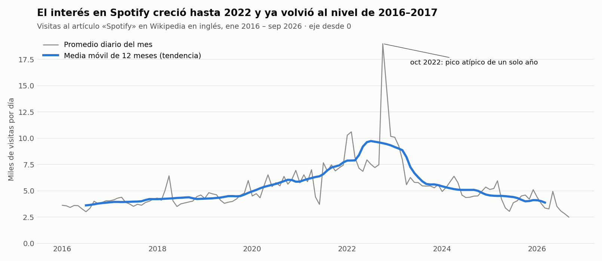
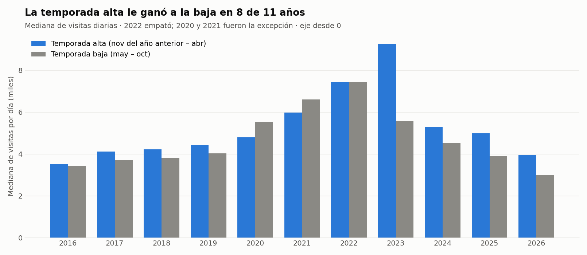

# Actividad calificable · Corte 3 — Análisis temporal y visualización

**Programa:** Ingeniería Industrial · **Asignatura:** Ciencia de Datos · **Periodo:** 2026-B
**Unidad 3 · Semana 14** · **Entrega:** individual (fork del repositorio de la clase) · **Valor:** 5.0

**Julián Andrés Solano Ledesma**

> Caso de trabajo: **Spotify — capacidad de streaming y curaduría regional**. Se analiza una serie temporal real con `resample` y media móvil, se construyen dos visualizaciones con su conclusión en el título y se optimiza una consulta SQL ligada al indicador de demanda.

| Entregable | Archivo |
|---|---|
| Serie temporal, gráficos y medición SQL (cuaderno ejecutado) | [`analisis-temporal.ipynb`](analisis-temporal.ipynb) |
| Visualizaciones | [`img/evolucion-tendencia.png`](img/evolucion-tendencia.png) · [`img/comparacion-temporadas.png`](img/comparacion-temporadas.png) |
| Consulta antes y después | [`consulta-antes-despues.sql`](consulta-antes-despues.sql) |
| Medición de la consulta | [`datos/medicion-sql.csv`](datos/medicion-sql.csv) |

---

## 1. Findings

*(English section — requirement of the activity.)*

The time series is the daily number of views of the "Spotify" article on English Wikipedia from January 2016 to September 2026, used as a proxy for public interest in the service. The 12-month moving average shows a clear long-term trend: it rose from about 3,600 daily views in 2016 to a peak of about 9,700 in mid-2022, and then fell to about 3,900 by early 2026, close to its 2016–2017 level. The series also has an annual seasonal pattern: December is typically 10.5% above the trend and June 12.7% below it, and August stayed below the trend in all 10 years measured. The evolution chart shows the monthly average together with its moving average, which separates this long-term rise and fall from the monthly noise and from an atypical peak in October 2022. The comparison chart shows the median daily views of the high season (November–April) against the low season (May–October), and the high season won in 8 of 11 years, with a tie in 2022 and the opposite result in 2020 and 2021. Because these figures measure attention on Wikipedia and not actual plays, the pattern should be confirmed with internal streaming data before any capacity decision is made.

---

## 2. Serie temporal: `resample` y media móvil

**Serie.** Visitas diarias al artículo *Spotify* de Wikipedia en inglés, obtenidas de la API de Wikimedia [1] en la Semana 11: **3 926 días** (1 ene 2016 – 30 sep 2026), sin nulos. La actividad en Wikipedia se ha usado como señal del interés del público [2]. Aquí aproxima la demanda, porque el dataset de Kaggle del caso no tiene fechas.

```python
m = pd.DataFrame({"visitas_total": diaria.resample("MS").sum(),
                  "visitas_dia_prom": diaria.resample("MS").mean().round(1)})
m["media_movil_2x12"] = m["visitas_dia_prom"].rolling(12).mean().rolling(2).mean().shift(-6).round(1)
```

- **`resample("MS")`** agrega la serie por mes [3]. Se analiza el promedio diario de cada mes para que los meses cortos, como febrero, no parezcan más bajos solo por tener menos días.
- **La media móvil de 12 meses** abarca un año completo, así que los meses altos y bajos se compensan y queda la tendencia. Se centra con un 2×12 para que cada valor corresponda a un mes exacto [4].

### Interpretación

**Tendencia.** La media móvil sube de **3 611** visitas diarias (julio de 2016) a un máximo de **9 730** (julio de 2022) y baja a **3 877** (marzo de 2026), cerca del nivel de 2016–2017.

**Estacionalidad.** Cada mes se dividió entre su tendencia y se tomó la mediana por mes de calendario, para que un mes atípico no defina el patrón [4].

| Mes | Efecto típico sobre la tendencia | Años por encima de la tendencia |
|---|---:|---:|
| Diciembre | **+10,5 %** | 8 de 10 |
| Abril | +8,7 % | 6 de 9 |
| Marzo | +7,9 % | 6 de 10 |
| Junio | **−12,7 %** | 0 de 9 |
| Julio | −11,2 % | 2 de 10 |
| Agosto | −6,7 % | 0 de 10 |

**Implicación para el caso.** Los meses de noviembre a abril son los candidatos para reforzar la capacidad, y junio–agosto, para hacer mantenimientos.

---

## 3. Dos visualizaciones

### Evolución



*Fig. 1. Evolución del interés en Spotify. Elaboración propia con datos de [1], graficado con Matplotlib [5].*

**Por qué este gráfico.** La evolución en el tiempo se muestra con líneas [6]. La serie mensual queda en gris, como contexto, y la tendencia en azul, porque es el mensaje del título. El eje empieza en 0, aunque un gráfico de líneas podría no hacerlo, para no exagerar los cambios. El pico de octubre de 2022 se anota porque es atípico: no se repite en ningún otro año.

### Comparación



*Fig. 2. Temporada alta frente a temporada baja por año. Elaboración propia con datos de [1], graficado con Matplotlib [5].*

**Por qué este gráfico.** Comparar categorías se hace con barras [6], y las longitudes sobre una misma escala se comparan con más precisión que los ángulos o las áreas [7]. El eje empieza en 0, porque en barras la longitud debe ser proporcional al valor [8]. Se usa la mediana diaria para que el pico de 2022 no decida la comparación.

**Lectura honesta.** La temporada alta ganó en **8 de 11 años**, pero el patrón no es universal: 2022 fue un empate (7 431 frente a 7 428), y en 2020 y 2021 ganó la baja. La temporada alta de 2023 (+66,6 %) incluye noviembre y diciembre de 2022, justo después del pico atípico, así que esa diferencia está inflada. Las últimas tres temporadas muestran una brecha creciente: +16,8 %, +27,6 % y +32,0 %. El año 2016 no incluye noviembre y diciembre de 2015, y la temporada baja de 2026 llega solo hasta septiembre.

---

## 4. Optimización de una consulta SQL

**Indicador.** Horas escuchadas por mes en la temporada alta de noviembre de 2024 a abril de 2025. Sirve para dimensionar la capacidad en los meses que señaló la sección 2.

**Datos.** Una serie diaria de 3 926 filas no permite medir mejoras. Por eso se usa la tabla de **2 000 000 de eventos de reproducción de la Semana 14**: es **sintética**, con semilla fija, y está calibrada con el dataset de Kaggle [9] y con la estacionalidad de la sección 2. El periodo consultado abarca **524 910 filas (26 %)**. El motor es SQLite [10].

```sql
-- ANTES: y luego se suman los segundos por mes en Python
SELECT * FROM reproduccion
WHERE  strftime('%Y-%m', fecha_hora) BETWEEN '2024-11' AND '2025-04';

-- DESPUÉS
CREATE INDEX idx_c3_cubre ON reproduccion (fecha_hora, segundos_escuchados);

SELECT substr(fecha_hora, 1, 7) AS mes, ROUND(SUM(segundos_escuchados) / 3600.0, 1) AS horas
FROM   reproduccion
WHERE  fecha_hora >= '2024-11-01' AND fecha_hora < '2025-05-01'
GROUP  BY mes ORDER BY mes;
```

| Versión (mediana de 5 ejecuciones) | Tiempo | Mejora | Filas devueltas | Plan de ejecución |
|---|---:|---:|---:|---|
| **Antes:** `SELECT *` + función en el `WHERE` + suma en Python | 1 754 ms | — | 524 910 | `SCAN` |
| Filtro por rango y `GROUP BY` en SQL, sin índice | 558 ms | ×3,1 | 6 | `SCAN` |
| Filtro por rango + índice simple en `fecha_hora` | 3 410 ms | ×0,5 (**más lenta**) | 6 | `SEARCH USING INDEX` |
| **Después:** filtro por rango + índice de cobertura | **281 ms** | **×6,2** | 6 | `SEARCH USING COVERING INDEX` |

Las cuatro versiones devuelven **el mismo resultado**, comprobado por código. Los tiempos corresponden a este equipo; en otro cambian, pero las proporciones son la referencia.

### Por qué mejora

1. **Filtro por rango en lugar de función.** `strftime()` se calcula en cada fila e impide buscar con un índice, porque el índice guarda la columna tal cual. Comparar la columna sin transformarla sí permite usarlo [11], [12]. Funciona porque las fechas en formato ISO 8601 se ordenan cronológicamente como texto.
2. **Solo lo necesario y agregado en SQL.** La base devuelve 6 filas en lugar de 524 910 y evita sumarlas en Python [12].
3. **El índice simple empeora esta consulta.** Encuentra las filas rápido, pero salta a la tabla una vez por cada una de las 524 910 para leer `segundos_escuchados`. Con una parte tan grande de la tabla, esos saltos cuestan más que un recorrido completo [13]. Por eso hay que medir [12].
4. **El índice de cobertura elimina esos saltos.** Es un árbol B ordenado por fecha [14] que también contiene `segundos_escuchados`, así que la consulta se resuelve leyendo solo el índice [13].

**Costo.** El índice ocupa espacio y encarece cada inserción [13]. Se justifica si este indicador se consulta con frecuencia, como en un tablero, y la tabla se carga por lotes.

---

## 5. Cómo reproducirlo

Desde esta carpeta del repositorio. El cuaderno lee la serie de la Semana 11 y usa el generador de eventos de la Semana 14, que crea `../datos/eventos.db` (unos 150 MB, excluido de Git) en cerca de 15 segundos.

```bash
pip install pandas requests matplotlib jupyter
jupyter notebook analisis-temporal.ipynb   # ejecutar todas las celdas
```

**Limitaciones.** Las visitas a Wikipedia miden atención, no reproducciones, y su audiencia en inglés puede no representar a todos los mercados. Los eventos de la sección 4 son sintéticos: sirven para medir el rendimiento de la consulta, no para sacar conclusiones de negocio.

---

## 6. Referencias (formato IEEE)

[1] Wikimedia Foundation, "Wikimedia REST API: Pageviews per article," 2026. [Online]. Disponible: https://wikimedia.org/api/rest_v1/ (consultado: 12 oct. 2026).

[2] M. Mestyán, T. Yasseri, and J. Kertész, "Early prediction of movie box office success based on Wikipedia activity big data," *PLoS ONE*, vol. 8, no. 8, Art. no. e71226, 2013, doi: 10.1371/journal.pone.0071226.

[3] Corporación Universitaria del Huila (CORHUILA), "Ciencia de Datos · Semana 11 · Análisis temporal y series de tiempo," Objeto Virtual de Aprendizaje (OVA), Neiva, Colombia, 2026. [Online]. Disponible: https://code-corhuila.github.io/ova-web/2026-B/ciencia-datos/11-week/01-session/

[4] R. J. Hyndman and G. Athanasopoulos, *Forecasting: Principles and Practice*, 3rd ed. Melbourne, Australia: OTexts, 2021, cap. 3, "Time series decomposition." [Online]. Disponible: https://otexts.com/fpp3/

[5] J. D. Hunter, "Matplotlib: A 2D graphics environment," *Computing in Science & Engineering*, vol. 9, no. 3, pp. 90–95, 2007, doi: 10.1109/MCSE.2007.55.

[6] Corporación Universitaria del Huila (CORHUILA), "Ciencia de Datos · Semana 12 · Visualización de datos," Objeto Virtual de Aprendizaje (OVA), Neiva, Colombia, 2026. [Online]. Disponible: https://code-corhuila.github.io/ova-web/2026-B/ciencia-datos/12-week/01-session/

[7] W. S. Cleveland and R. McGill, "Graphical perception: Theory, experimentation, and application to the development of graphical methods," *Journal of the American Statistical Association*, vol. 79, no. 387, pp. 531–554, 1984, doi: 10.1080/01621459.1984.10478080.

[8] E. R. Tufte, *The Visual Display of Quantitative Information*, 2nd ed. Cheshire, CT, USA: Graphics Press, 2001.

[9] A. Soundankar, "Spotify Global Streaming Data (2024)," Kaggle, 2024. [Online]. Disponible: https://www.kaggle.com/datasets/atharvasoundankar/spotify-global-streaming-data-2024

[10] K. P. Gaffney, M. Prammer, L. Brasfield, D. R. Hipp, D. Kennedy, and J. M. Patel, "SQLite: Past, present, and future," *Proceedings of the VLDB Endowment*, vol. 15, no. 12, pp. 3535–3547, 2022, doi: 10.14778/3554821.3554842.

[11] P. G. Selinger, M. M. Astrahan, D. D. Chamberlin, R. A. Lorie, and T. G. Price, "Access path selection in a relational database management system," in *Proc. 1979 ACM SIGMOD Int. Conf. Management of Data*, Boston, MA, USA, 1979, pp. 23–34, doi: 10.1145/582095.582099.

[12] Corporación Universitaria del Huila (CORHUILA), "Ciencia de Datos · Semana 14 · Optimización de consultas y métricas (SQL y DAX)," Objeto Virtual de Aprendizaje (OVA), Neiva, Colombia, 2026. [Online]. Disponible: https://code-corhuila.github.io/ova-web/2026-B/ciencia-datos/14-week/01-session/

[13] R. Ramakrishnan and J. Gehrke, *Database Management Systems*, 3rd ed. New York, NY, USA: McGraw-Hill, 2003.

[14] D. Comer, "The ubiquitous B-tree," *ACM Computing Surveys*, vol. 11, no. 2, pp. 121–137, 1979, doi: 10.1145/356770.356776.
