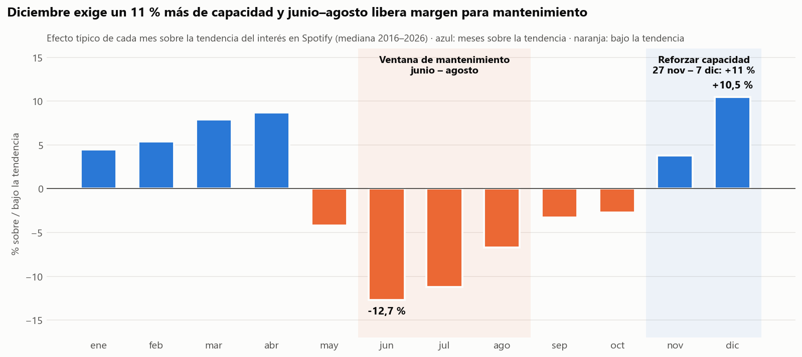
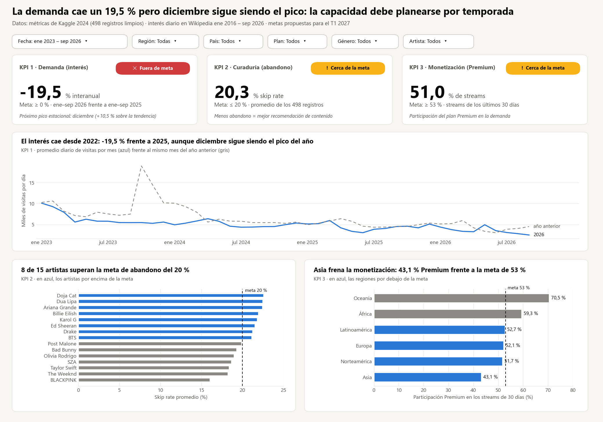

# Semana 15 — Storytelling del proyecto final

**Programa:** Ingeniería Industrial · **Asignatura:** Ciencia de Datos
**Unidad 3:** Análisis temporal, visualización y optimización · **Corte 3 · Semana 15** · **Periodo:** 2026-B
**Modalidad:** Individual/parejas · **Tipo:** Formativa (sin nota)

**Julián Andrés Solano Ledesma**

> Cierre del caso **Spotify — capacidad de streaming y curaduría regional**. La narrativa de una página recorre el camino *contexto → pregunta → hallazgo → recomendación accionable* [1], apoyada en el gráfico clave del proyecto. Después se revisa que cada vista del dashboard tenga un título con conclusión.

Un gráfico informa, pero una historia guía al lector hacia una decisión. La narrativa se estructura como un relato dirigido por el autor, que conduce a un mensaje central antes de dejar explorar el detalle [2], y cierra con lo que la audiencia debe hacer [3].

---

## 1. Storytelling (1 página)

### Contexto

Spotify opera en 20 mercados con una demanda que no se reparte de forma pareja en el tiempo. Durante el curso se construyó un ciclo de datos completo sobre este caso:

- **Datos y modelo:** el dataset de Kaggle [4] se modeló en un ERD (Semana 6), se limpió (Semana 9) y se cargó en una base consultable (Semana 10).
- **Dimensión temporal:** se incorporó con el interés diario del público en Wikipedia [5], entre 2016 y 2026 (Semana 11).
- **Monitoreo:** todo se resumió en un tablero con 3 KPI (Semana 13).

### Pregunta

*¿En qué momentos del año y en qué mercados aumenta la demanda, para escalar la capacidad a tiempo y priorizar el contenido en cada región?*

### Hallazgo

**El interés por Spotify cae un 19,5 % frente a 2025, pero su calendario es muy predecible.**



*Fig. 1. Gráfico clave: efecto típico de cada mes sobre la tendencia del interés (mediana 2016–2026). Elaboración propia con datos de [5], graficado con Matplotlib [6].*

- **Diciembre está un 10,5 % sobre la tendencia**, y en 9 de 10 años su día pico cayó entre el 27 de noviembre y el 7 de diciembre. **Junio está un 12,7 % por debajo**, y agosto quedó bajo la tendencia los 10 años. El índice estacional se calculó con la descomposición clásica [7].
- **La demanda está repartida:** ningún país supera el 6,6 % del total. Los 10 mercados por encima del reparto uniforme del 5 % suman el **58 %** de los streams recientes (Semana 12).
- **En Latinoamérica, Taylor Swift y The Weeknd** combinan alta demanda con el menor abandono (14,4 % y 13,4 %), mientras el *skip rate* de la región está en 21,0 %, por encima de la meta del 20 % (semanas 10 y 13).

### Recomendación accionable

Las dos acciones se formulan como objetivos SMART: específicas, medibles, alcanzables, relevantes y con fecha [8].

| | Acción | Responsable | Plazo | Indicador | Línea base → meta |
|---|---|---|---|---|---|
| **1** | Aprovisionar **un 11 % más de capacidad** de servidores y CDN sobre la tendencia en los **10 mercados que concentran el 58 % de la demanda**. Mover mantenimientos y migraciones a junio–agosto. | Infraestructura | 27 nov – 7 dic 2026 · jun–ago 2027 | Incidentes de degradación en la semana pico | → **0 incidentes** |
| **2** | Dar prioridad en las playlists de **Argentina, Brasil y México** a Taylor Swift y The Weeknd. | Contenido | T1 2027 | *Skip rate* de Latinoamérica (KPI 2, semanal) | 21,0 % → **≤ 20 %** |

**Por qué estas dos acciones:** la primera aprovecha lo más estable que encontró el análisis, el calendario. Reserva capacidad solo donde y cuando hace falta, y usa la temporada baja para el mantenimiento. La segunda corrige el único KPI de contenido fuera de meta, y lo hace con los artistas que ya demostraron retener a la audiencia.

**Supuesto honesto:** el interés en Wikipedia aproxima la atención del público, no las reproducciones. Antes de ejecutar la acción 1 conviene confirmar el patrón con los eventos internos de streaming del pipeline de la Semana 8.

---

## 2. Revisión: cada vista del dashboard con un título que dice la conclusión

El título es lo primero que se lee y orienta el mensaje que el lector recuerda [9]; una vista sin conclusión obliga a interpretar sola cada cifra [3]. Se revisó el tablero de la Semana 13 vista por vista. El único título que no decía una conclusión era el **título principal**, y se reescribió en la versión 2.

| Vista | Título en la versión 1 (Semana 13) | ¿Dice la conclusión? | Versión 2 |
|---|---|:---:|---|
| Título principal | "Tablero de operación · Spotify: demanda, curaduría y monetización" | ✗ Solo describe | **"La demanda cae un 19,5 % pero diciembre sigue siendo el pico: la capacidad debe planearse por temporada"** |
| Tarjetas KPI 1–3 | Nombre del KPI + semáforo ("Fuera de meta", "Cerca de la meta") | ✓ El semáforo dice el estado | Sin cambios |
| Tendencia (KPI 1) | "El interés cae desde 2022: −19,5 % frente a 2025, aunque diciembre sigue siendo el pico del año" | ✓ | Sin cambios |
| Abandono (KPI 2) | "8 de 15 artistas superan la meta de abandono del 20 %" | ✓ | Sin cambios |
| Premium (KPI 3) | "Asia frena la monetización: 43,1 % Premium frente a la meta de 53 %" | ✓ | Sin cambios |
| Gráfico clave (esta semana) | "Diciembre exige un 11 % más de capacidad y junio–agosto libera margen para mantenimiento" | ✓ | — |



*Fig. 2. Dashboard versión 2: el título principal ahora dice la conclusión. Elaboración propia con datos de [4] y [5], graficado con Matplotlib [6].*

---

## 3. Video de 2 minutos (opcional)

El video es opcional y no se grabó en esta entrega. Este guion sirve para grabarlo explicando el tablero (Fig. 2):

| Tiempo | Qué decir | Qué mostrar |
|---|---|---|
| 0:00–0:20 | Contexto y pregunta: dónde y cuándo crece la demanda | Título principal del tablero |
| 0:20–0:50 | Los 3 KPI y su semáforo: el interés está fuera de meta (−19,5 %); el abandono y Premium, cerca | Tarjetas KPI |
| 0:50–1:20 | Hallazgo: diciembre +10,5 %, junio −12,7 %, patrón que se repite cada año | Gráfico clave (Fig. 1) |
| 1:20–1:45 | Dónde actuar: 8 artistas sobre la meta de abandono; Latinoamérica en 21 % | Gráfico de abandono |
| 1:45–2:00 | Recomendación: +11 % de capacidad del 27 nov al 7 dic, y playlists en Latinoamérica con meta ≤ 20 % | Tabla de recomendación |

---

## 4. Archivos de la entrega

```
15-week/02-optional-activity/
├── README.md                               ← storytelling, revisión de títulos y guion del video
├── storytelling_spotify.py                 ← genera el gráfico clave y el dashboard v2
└── img/
    ├── grafico-clave-estacionalidad.png    ← Fig. 1: gráfico clave
    └── dashboard-v2.png                    ← Fig. 2: tablero con títulos revisados
```

**Cómo reproducirlo** (desde esta carpeta; reutiliza el código y los datos de las semanas 10, 11 y 13):

```bash
pip install pandas requests matplotlib
python storytelling_spotify.py
```

---

## 5. Referencias (formato IEEE)

[1] Corporación Universitaria del Huila (CORHUILA), "Ciencia de Datos · Semana 15 · Cierre del curso y proyecto final," Objeto Virtual de Aprendizaje (OVA), Neiva, Colombia, 2026. [Online]. Disponible: https://code-corhuila.github.io/ova-web/2026-B/ciencia-datos/15-week/01-session/

[2] E. Segel and J. Heer, "Narrative visualization: Telling stories with data," *IEEE Transactions on Visualization and Computer Graphics*, vol. 16, no. 6, pp. 1139–1148, 2010, doi: 10.1109/TVCG.2010.179.

[3] C. Nussbaumer Knaflic, *Storytelling with Data: A Data Visualization Guide for Business Professionals*. Hoboken, NJ, USA: Wiley, 2015.

[4] A. Soundankar, "Spotify Global Streaming Data (2024)," Kaggle, 2024. [Online]. Disponible: https://www.kaggle.com/datasets/atharvasoundankar/spotify-global-streaming-data-2024

[5] Wikimedia Foundation, "Wikimedia REST API: Pageviews per article," 2026. [Online]. Disponible: https://wikimedia.org/api/rest_v1/ (consultado: 12 oct. 2026).

[6] J. D. Hunter, "Matplotlib: A 2D graphics environment," *Computing in Science & Engineering*, vol. 9, no. 3, pp. 90–95, 2007, doi: 10.1109/MCSE.2007.55.

[7] R. J. Hyndman and G. Athanasopoulos, *Forecasting: Principles and Practice*, 3rd ed. Melbourne, Australia: OTexts, 2021, cap. 3, "Time series decomposition." [Online]. Disponible: https://otexts.com/fpp3/

[8] G. T. Doran, "There's a S.M.A.R.T. way to write management's goals and objectives," *Management Review*, vol. 70, no. 11, pp. 35–36, 1981.

[9] H.-K. Kong, Z. Liu, and K. Karahalios, "Frames and slants in titles of visualizations on controversial topics," in *Proc. 2018 CHI Conf. Human Factors in Computing Systems*, Montreal, QC, Canada, 2018, pp. 1–12, doi: 10.1145/3173574.3174012.
